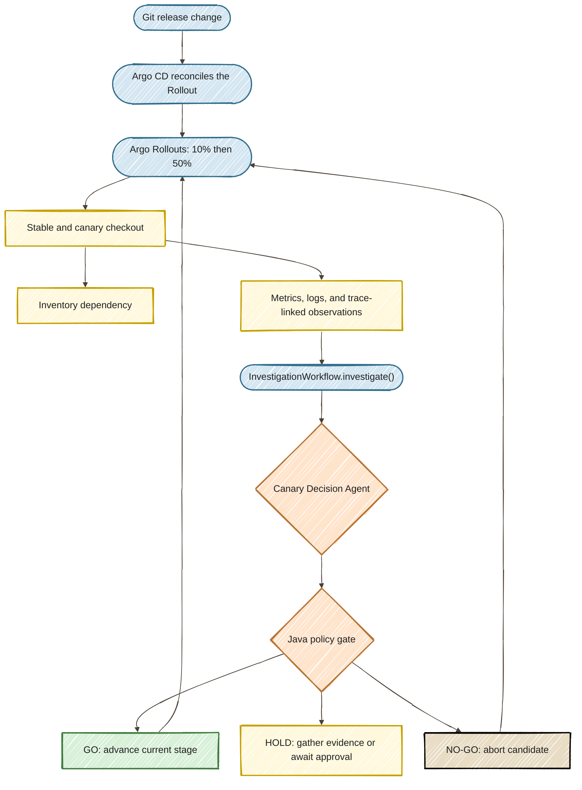

# Intelligent Canary Delivery

**From Static Rules to Reasoning Platforms: Scaling Intelligent Canary Delivery in 2026**

**[Read the step-by-step tutorial](https://danieloh30.github.io/intelligent-canary-delivery/)**

A Kubernetes tech demo with four Java agents built using Quarkus and LangChain4j `@Agent`, a presenter SPA, and governed Argo Rollouts analysis. Run a complete story in **10 minutes**, or inspect investigation tools and governance in **15 minutes**.

The cluster installation targets a fresh **OpenShift 4.22** cluster. The application architecture uses Kubernetes APIs; OpenShift supplies operator lifecycle, image builds, an internal registry, and the external Route. The installer must be rehearsed on a real cluster before presenting; local tests do not establish operator compatibility.

## The story

A checkout service calls inventory. Three prepared release behaviors make the demonstration reproducible:

- **v1:** stable checkout, one inventory attempt.
- **v2:** healthy candidate, one attempt. A presenter-injected shared inventory slowdown makes a basic latency threshold fail. The agent team distinguishes shared trouble from a release-specific regression, holds during the incident, and proceeds only after recovery.
- **v3:** retry regression. Inventory deliberately returns four retryable responses to this revision before accepting the fifth attempt. Checkout succeeds, but dependency work grows. The basic HTTP checks pass while the investigators recommend NO-GO.

Faults and traffic are synthetic, while cluster-mode requests, timings, metrics, trace IDs, pod logs, and rollout actions are real. The inventory response fault is a controlled demonstration of the retry pattern, not a claim to reproduce a production outage.

## Architecture



All agents run in **one Quarkus deployment**. A declarative `@SequenceAgent` workflow runs metrics first, a nested `@ParallelAgent` runs dependency and release agents concurrently, and the decision agent runs last. Each interface has one `@Agent` entry point and a distinct output key. `@ToolBox` restricts specialists to read-only tools. The outer Java service bounds execution time and records state transitions, while each workflow invocation uses its own memory ID.

Every agent uses **`gpt-4o-mini`**, configured through Quarkus LangChain4j. `OPENAI_API_KEY` remains on the server; it is never sent to the browser. There is no silent fallback from live AI to fixtures.

The investigator reads a **frozen 60-second request observation window from every running stable/canary checkout pod**. These observations contain actual OTel trace IDs, timings, outcomes, and attempt counts. The dependency tool exposes trace-linked request summaries, not complete trace trees. Complete spans are exported to Jaeger. The log tool uses the corresponding bounded structured request records; the live console separately retrieves actual Kubernetes pod logs. Prometheus scrapes actual Micrometer counters for independent inspection. This first implementation does not query Loki or use an external vector database.

The release tool reads the small allowlisted v1/v2/v3 release catalog. The runbook tool retrieves the bundled `retry-budget/v1` guidance, not semantic vector search. Agent outputs are hypotheses and recommendations, not proof of causality.

## Requirements

Local development:

- JDK **25**, Git, and an internet connection for Maven dependencies.
- `OPENAI_API_KEY` for real model calls. No key is needed for explicit offline rehearsal.
- Node.js **22+** only for browser tests. The SPA has no runtime npm dependencies.

Cluster installation:

- A fresh OpenShift 4.22 cluster, logged in with `oc login` using administrator access.
- `oc`, Python 3, Git, and optionally the Argo Rollouts CLI plugin.
- Cluster image registry enabled, registry storage configured, and outbound access to Maven Central, Docker Hub, Quay, GitHub, and the OpenAI API.
- Capacity for 10 checkout replicas plus the control service, inventory, traffic generator, Prometheus, Jaeger, and GitOps components. Start with at least **8 GiB free workload memory**; verify actual usage during rehearsal.
- This repository available to Argo CD. The default URL is `https://github.com/danieloh30/intelligent-canary-delivery.git`. For a private fork, configure Argo CD repository credentials separately.

## Run locally

```bash
git clone https://github.com/danieloh30/intelligent-canary-delivery.git
cd intelligent-canary-delivery
export OPENAI_API_KEY='your-key'  # prefer your shell's secret manager
./demo.sh dev
```

Open **http://localhost:8095**. Set `DEMO_PORT` to use another port. The local presenter token is **`demo-local`**. Local mode uses clearly labeled rehearsal evidence with real GPT-4o mini agents. It cannot authorize a cluster rollout.

For deterministic UI rehearsal without API calls:

```bash
./demo.sh rehearsal
```

The UI labels this **Offline rehearsal / deterministic fixtures**. This is a presentation fallback, not a claim that an LLM produced the result.

## Install on OpenShift

Publish or fork the repository first. Then:

```bash
oc login YOUR_CLUSTER_API
export OPENAI_API_KEY='your-key'
export REPO_URL=https://github.com/danieloh30/intelligent-canary-delivery.git
./demo.sh install
./demo.sh doctor
```

The script:

1. Checks login and subscription-install permissions and prints the target cluster/version.
2. Installs the Red Hat OpenShift GitOps Operator from the catalog's default channel if absent. Set `GITOPS_CHANNEL` to select an approved channel. Existing installations are reused without changing their configuration.
3. Creates the dedicated `canary-demo` namespace and a cluster-scoped RolloutManager in `openshift-gitops` when none exists. A new operator subscription configures those two namespaces; existing installations retain their configuration and need compatible controller scope.
4. Stores the model key and a generated presenter token in a namespace Secret, through private temporary files.
5. Builds the Java application in the cluster using a binary Docker build. Only Dockerfile, pom.xml, and src enter the portable GNU-format build archive. Python creates it without macOS extended-attribute headers.
6. Pins the cluster build digest, then deploys workloads, the reasoning service, read-only observer RBAC, Prometheus, Jaeger, and an HTTPS Route.
7. Creates an Argo CD Application owning the checkout Rollout and shared AnalysisTemplate. Platform resources are installer-owned; release resources are Git-owned. The Application applies an immutable image-digest override to the release manifests.

The script is rerunnable and reuses the presenter token. It does not uninstall existing operators or delete namespaces. A rerun builds the latest local source and updates the immutable image digest. Before a presentation, avoid rebuilding once baseline and candidate behavior have been verified.

Retrieve the token locally and enter it in the SPA:

```bash
oc -n canary-demo get secret canary-secrets -o jsonpath='{.data.api-token}' | base64 --decode
```

Do not paste cluster administrator credentials or API keys into the UI. The workload service account has no mounted Kubernetes token. The control service can read pods, logs, rollout state, and a single Argo CD Application; it cannot promote, patch, or delete deployments. The authenticated presenter API controls only the deliberately exposed inventory fault endpoint and decision approvals.

The external page shell is public, but all `/api/*` and `/internal/*` data requires the presenter token. The browser stores it only in session storage and sends it in an Authorization header. Treat this as a dedicated demo environment, not a production identity system.

## Present the demo

Select **10 minutes / Core** or **15 minutes / Extended** in the SPA. The timer is presenter-controlled; changing duration does not alter agent behavior or safety policy.

### Core: 10 minutes

1. **Establish (1 minute).** Verify v1 is Healthy, traffic is flowing, and the model key works. Ask: “Should this release get more traffic?”
2. **Noise (2.5 minutes).** Run `./demo.sh release v2`. Wait until the 10% analysis is running and the canary has at least 30 observations. Select Shared slowdown and inject 25 seconds of latency. Investigate: the basic latency check fails; agents should HOLD. Clear the fault, wait for the affected 60-second window to drain, then investigate again. GO allows the current analysis step to proceed. Evaluate again at 50%.
3. **Gray failure (4 minutes).** Run `./demo.sh release v3`. Wait for canary samples, choose Hidden retries, and investigate. The basic HTTP check should pass, while correlated retry amplification supports NO-GO. Watch actual Rollouts status and pod logs for the abort and stable recovery.
4. **Trust (1.5 minutes).** Inspect specialist findings, source labels, trace IDs, policy reasons, and the exported decision record.
5. **Developer experience (1 minute).** Show the shared AnalysisTemplate reference and the Git release diff.

The basic static check is a **comparison-only UI calculation** over the same signals. It does not drive a second live rollout. The agent-backed AnalysisTemplate drives the actual rollout. Better deterministic checks can detect retries too; the educational goal is investigation and context, not claiming AI is necessary for every failure.

Without a traffic-management provider, Argo Rollouts uses replica proportions to approximate weights. Ten replicas make 10% and 50% easy to explain, but **replica share is not an exact request percentage**. No service mesh is installed for this first demo.

### Optional five minutes

- **+2 minutes:** follow a trace ID in Jaeger and match it to the checkout log record. Open the Java `@Agent` and `@Tool` definitions.
- **+3 minutes:** select Production policy for a healthy release. Show GO held pending approval. Then select Missing evidence, which deliberately withholds trace evidence and marks the outage in the decision record. Approval cannot override missing evidence, hard failure caps, or expiration.

### Stage timing and recovery

- Start all infrastructure before the talk. Do not build images or install operators on stage.
- Each stage needs a fresh investigation. A GO decision cannot authorize the next rollout step.
- Model work has an 85-second orchestration deadline and a 12-tool investigation budget. Model calls have bounded timeouts. Failure or timeout produces HOLD.
- Argo polls the decision endpoint every 5 seconds for up to 15 minutes. Pending decisions remain inconclusive. A completed inconclusive AnalysisRun does not automatically restart: use `./demo.sh retry-analysis` after addressing the cause, or release a fresh candidate.
- Scenarios can start independently. Use `./demo.sh release v1` to restore the intended baseline, clear the inventory fault, and verify Healthy before the next rehearsal. Release v1 may still require investigation if it updates an existing rollout.
- If time is short, start at Hidden retries and show the pre-rehearsed healthy baseline. Skip optional inspection rather than bypassing gates.
- If live infrastructure or the model is unavailable, open the separately labeled local rehearsal. Never present fixture output as live AI or live Kubernetes evidence.

## Inspect observability

The SPA Live Console offers bounded tails from checkout, inventory, Quarkus control, Argo Rollouts, and Argo CD. It polls every four seconds; it is not an unbounded streaming log collector. Controller labels can differ by operator version; `./demo.sh doctor` shows labels for diagnosis.

```bash
oc -n canary-demo port-forward svc/jaeger 16686:16686
# Open http://localhost:16686 and select checkout; use evidence trace IDs.
```

```bash
oc -n canary-demo port-forward svc/prometheus 9090:9090
# Inspect checkout_requests_total and checkout_dependency_attempts_total.
```

Decision records and recent observations are bounded **in-memory demo data**. Export records from the UI before restarting the control service. Jaeger and Prometheus use ephemeral storage. Durable audit storage and production retention are deliberately outside this demonstration.

## Build and test

```bash
./mvnw verify
python3 scripts/check-manifests.py
python3 scripts/check-diagrams.py
python3 -m unittest discover -s tests/scripts -v
bash -n demo.sh scripts/*.sh
npm ci
npx playwright install chromium
# In another terminal, run the packaged artifact:
DEMO_AI_MODE=fixture DEMO_API_TOKEN=browser-test QUARKUS_OTEL_SDK_DISABLED=true \
  java -jar target/quarkus-app/quarkus-run.jar
npm test
```

Tests cover policy enforcement, authentication, offline isolation, four-agent tool execution against an OpenAI protocol stub, repeat-investigation memory isolation, installer control flow against a mocked oc CLI, SPA interactions, approval, mobile layout, and manifest structure. Browser tests require permission to launch Chromium; they are also configured in GitHub CI. Real-cluster admission, OperatorHub availability, registry builds, controller RBAC, service routing, OTLP export, and actual GPT-4o mini behavior require a live integration rehearsal.

## Daily updates and auto-merge

Dependabot checks Maven (including the Quarkus platform and LangChain4j BOM), npm browser-test dependencies, Docker base images, and GitHub Actions every day. Dependabot PRs have automatic squash merging enabled by a narrowly scoped workflow that never checks out PR code under `pull_request_target`.

Run `./scripts/publish-github.sh` with GitHub CLI authenticated as `danieloh30` to create the public repository, push main, enable auto-merge, and require the `verify` CI check with an up-to-date branch. **Branch protection is required for gated auto-merge.** If account permissions or repository settings reject protection, resolve that before enabling the auto-merge workflow. The first GitHub CI run must establish the required check.

Container images declared inside Kubernetes manifests are pinned separately and need review; the Docker Dependabot ecosystem updates Dockerfile base images, not those embedded manifest image references.

## Build the tutorial site

The GitHub Pages site provides local setup, OpenShift installation, the investigation walkthrough, governance, agent implementation, API reference, troubleshooting, and a presenter playbook. It uses a distinct navy-and-mint tutorial design with the shared expandable paper diagrams.

```bash
python3.13 -m venv .docs-venv
source .docs-venv/bin/activate
pip install -r requirements-docs.txt
mkdocs serve
# Or validate the static output:
mkdocs build --strict
npx playwright test -c playwright.docs.config.js
```

The Pages workflow builds and browser-tests the site before publishing main. Documentation dependencies receive daily Dependabot checks. The build hook copies the exact Mermaid renderer and solid-fill adapter from the SPA, so the site and demo retain the same diagram behavior.

## Diagram style

All Mermaid charts follow the [agentic Java workshop reference](https://danieloh30.github.io/agentic-ai-java-workshop/01-first-agent/START_HERE/#step-3-understand-the-agent-loop): hand-drawn outlines, solid pastel fills, a light paper frame, dark text, and matching expanded views. Open **Architecture** in the SPA to expand either diagram. README and documentation blocks share the same `.mmd` sources; `scripts/check-diagrams.py` prevents drift. The Mermaid 12.1.0 browser bundle is vendored for offline rendering and retains its license notices. Its version is reviewed separately from npm dependency updates.

## Implementation map

- `src/main/java/dev/danieloh/canary/agents/`: four agents and their scoped toolboxes.
- `agents/InvestigationWorkflow`: declarative sequence with a parallel investigation stage.
- `InvestigationService`: deadlines, execution state, and policy enforcement.
- `EvidenceCollector`: cluster observations, shared time window, and revision matching.
- `DecisionPolicy`: deterministic safety and approval checks.
- `DemoResource`: presenter API and rollout analysis adapter.
- `WorkloadResource`: checkout, inventory, real request observations, OTel spans, and controlled faults.
- `src/main/resources/META-INF/resources/`: SPA, styles, and browser logic.
- `deploy/`: Kubernetes platform resources, OpenShift Route, and GitOps release configuration.
- `docs/`: presenter and audience guidance.

## References

- [Quarkus LangChain4j agentic workshop](https://quarkus.io/quarkus-workshop-langchain4j/section-2/step-01/)
- [Argo Rollouts web analysis](https://argoproj.github.io/argo-rollouts/analysis/web/)
- [Argo Rollouts analysis lifecycle](https://argoproj.github.io/argo-rollouts/features/analysis/)
- [Red Hat OpenShift GitOps Argo Rollouts](https://docs.redhat.com/en/documentation/red_hat_openshift_gitops/1.21/html/argo_rollouts/index)

Live-cluster details: the AnalysisTemplate uses the reasoning service’s full namespace-qualified DNS name because the Rollouts controller runs in `openshift-gitops`. Tool responses carry the investigation ID separately from trace IDs, and observations label their stable/canary cohort. Specialist prompts explicitly require their own tool reads; the policy holds any result with missing tool reads or unresolved evidence limitations.

The web analysis can wait up to 15 minutes on HOLD. If it has already finished inconclusively, `./demo.sh retry-analysis` commits a fresh identity for the current release through GitOps, creating a new analysis instead of skipping the gate.

OpenShift Topology uses `app.openshift.io/runtime: quarkus` on the Java workloads. Prometheus and Jaeger also set `app.openshift.io/custom-icon` to their official CNCF logo URLs because they are not built-in runtime icons. These are workload metadata labels/annotations and do not change service selectors.

Live integration rehearsal completed on OpenShift 4.22.18 with Java 25 and GPT-4o mini: shared slowdown HOLD; recovered health GO; production approval HOLD → GO; missing trace evidence HOLD; and v3 retry amplification NO-GO with a failed AnalysisRun and actual rollout abort. The v3 check observed zero HTTP errors, approximately 10 ms p95 latency, and five dependency attempts per checkout. Real-browser validation covered the cluster dashboard, controller logs, and both paper-style diagrams. LLM output is validated, not predetermined; invalid references or unresolved limitations remain HOLD and require investigation.

Argo CD UI access is configured separately from Kubernetes RBAC. Installation grants the current human OpenShift user read access to the demo application through `canary-demo-viewers`; set `DEMO_PRESENTER_USER` when installing for a different person. For an existing installation run `bash scripts/configure-argocd-access.sh <openshift-username>`, then sign out of Argo CD and log back in via OpenShift to refresh group claims.

### Open presenter tabs without copying tokens

```bash
./demo.sh open --local   # local app; uses DEMO_PORT (8095 by default)
./demo.sh open           # OpenShift dashboard; automatic OpenShift SSO
./demo.sh argo           # Argo CD; normal OpenShift SSO
./demo.sh present        # dashboard + Argo CD, ready for the live demo
```

Localhost automatically tries the development token `demo-local`. For a custom local `DEMO_API_TOKEN`, use the local launcher. On OpenShift, direct visits to the dashboard use OpenShift OAuth. The proxy checks whether your OpenShift user can get the `canary-control` Service in `canary-demo`; installation grants that permission to the chosen user through `canary-demo-presenters`. Your existing OpenShift session is reused; the first visit can require OpenShift login or OAuth consent. There is no presenter-token dialog on the authenticated route, and the browser never receives the backend API credential. The OAuth proxy forwards an authenticated username plus the Secret credential to the loopback backend. Proxy authentication is enabled only in the OpenShift overlay; Argo analysis retains its internal Bearer credential. Argo CD continues to use its separate SSO client.

The launcher no longer reads Kubernetes Secrets on OpenShift. Local mode still supports the known development credential or an exported custom `DEMO_API_TOKEN`; a local handoff fragment is consumed and removed immediately. API authorization remains enabled. The manual token dialog remains a fallback for deployments without the SSO overlay.

The core flow now explicitly visits Argo CD at baseline (Git revision and resource tree), recovered GO (Successful AnalysisRun and promotion), and NO-GO (Failed AnalysisRun, aborted Rollout, stable ReplicaSet). Prepare both tabs before starting the 10/15-minute timer.
