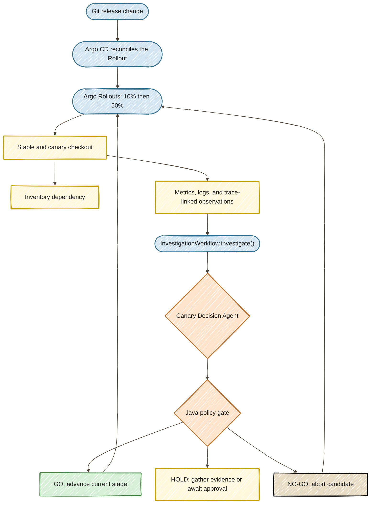
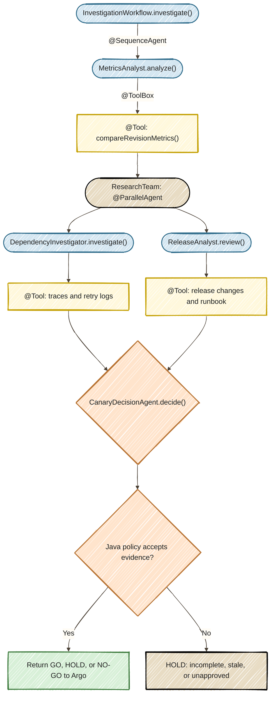

# Architecture and agent workflow

Diagrams follow the [Java agent workshop style](https://danieloh30.github.io/agentic-ai-java-workshop/01-first-agent/START_HERE/#step-3-understand-the-agent-loop): hand-drawn outlines, solid pastel fills, paper background, and dark labels. The SPA Architecture tab adds an expandable dialog.

## Delivery architecture

## Multi-agent investigation

