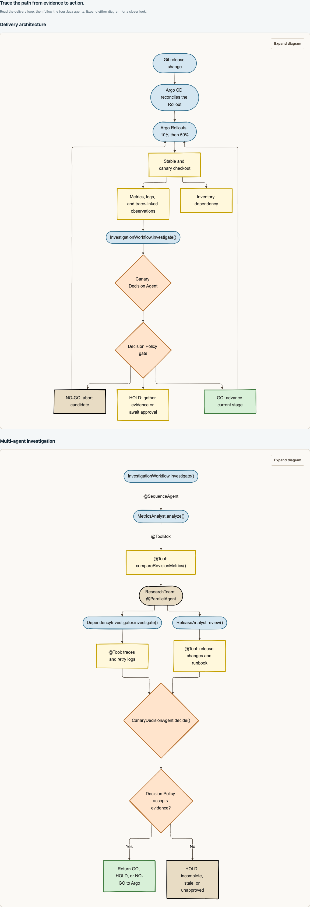
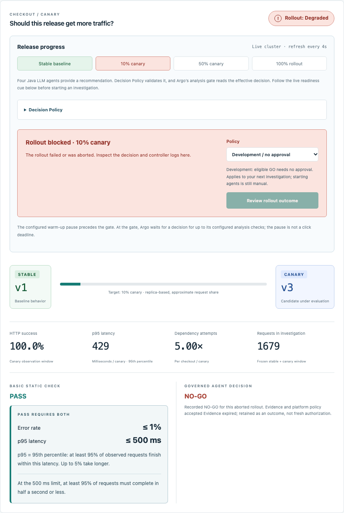
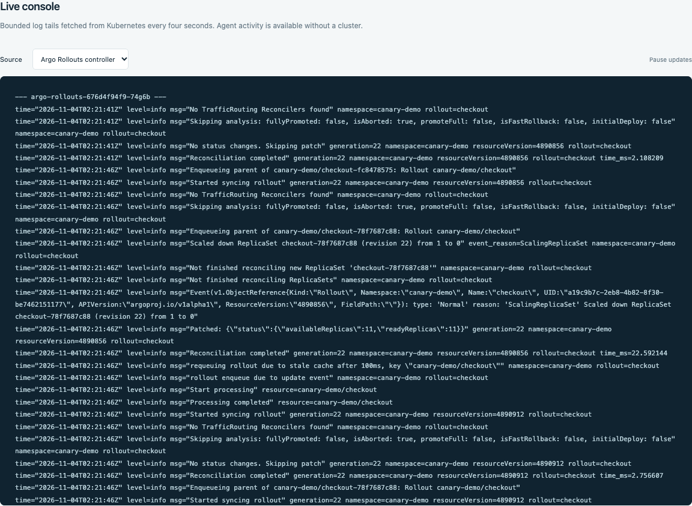

<div class="chapter-meta">02 / KUBERNETES INSTALLATION / OPENSHIFT 4.22</div>

# Connect the demo to Kubernetes

The application uses Kubernetes APIs and Argo resources. The installation script targets OpenShift 4.22, using its operator lifecycle, internal image registry, binary builds, and external Routes.

## 1. Prepare the cluster

Before running the installer, confirm:

- You can log in with `oc` as a cluster administrator.
- OperatorHub exposes the Red Hat OpenShift GitOps Operator.
- The image registry is enabled and has working storage.
- Builds and workloads can reach GitHub, Maven Central, Docker Hub, Quay, and the OpenAI API.
- At least **8 GiB of workload memory** is available as an initial planning allowance. Measure actual usage before presenting.

```bash
oc login YOUR_CLUSTER_API
oc whoami
oc get clusterversion version
```

!!! warning "Use a dedicated demo environment"
    The installer creates cluster-scoped GitOps components when they are absent. It reuses existing installations without changing their configuration. Existing Rollouts scope must be compatible with the `canary-demo` namespace.

## 2. Install

From your repository checkout:

```bash
export OPENAI_API_KEY='your-key'
export REPO_URL=https://github.com/danieloh30/intelligent-canary-delivery.git
./demo.sh install
```

Use your fork URL if you plan to commit releases from another repository. For a private repository, configure Argo CD credentials before expecting synchronization.

The script creates the dedicated **`canary-demo`** namespace. That namespace and the default **`openshift-gitops`** instance are currently fixed in the installer.

## 3. Understand the installation boundaries

The installer owns platform resources:

- The Quarkus control service, presenter SPA, inventory, and traffic generator.
- Scoped service accounts and observer roles.
- Prometheus, Jaeger, and the external dashboard Route.
- A Secret containing the model key and presenter token.

Argo CD owns release resources:

- The checkout `Rollout`.
- The shared `AnalysisTemplate` that calls the decision API.

The cluster build produces an immutable image digest. Platform deployments use that digest, and the Argo CD Application applies the same digest as a Kustomize image override. Changing a release version changes behavior and pod-template identity while keeping the verified application binary fixed.

Secrets pass through private temporary files and Kubernetes Secrets. They do not enter Git or the build context. The installer generates a portable GNU-format archive with Python so macOS metadata does not break the OpenShift source extractor.

## 4. Verify readiness

```bash
./demo.sh doctor
./demo.sh status
```

Check that the Argo CD Application is synchronized, the initial checkout release is healthy, and all workloads are ready. Confirm controller labels and log access; operator versions can use different labels.

[](../images/screenshots/12-architecture.png)

*Current SPA Architecture view: identify delivery components and the four-agent workflow. This is an architectural diagram, not an OpenShift Topology capture or proof of runtime health. Click any screenshot for full resolution.*

[](../images/screenshots/10-cluster-progress.png)

*Recorded live cluster responses captured on 2026-11-04 UTC and rendered in the current SPA. This example shows a rejected v3 candidate at 10%, stable v1, passing HTTP checks, and the retained NO-GO outcome. It illustrates failure inspection, not installation readiness: your starting baseline should show Healthy / Stable v1. No new rollout or model call was made to create this capture.*

[](../images/screenshots/14-controller-logs.png)

*Recorded controller logs from the same read-only cluster snapshot, displayed in Live console. Inspect the aborted flag and candidate ReplicaSet scaling; timestamps and resource names vary between runs.*


Retrieve the presenter token locally:

```bash
oc -n canary-demo get secret canary-secrets \
  -o jsonpath='{.data.api-token}' | base64 --decode
```

Open the HTTPS dashboard URL printed by the installer and enter that token.

!!! note "Installation success is not the end of rehearsal"
    The script checks resource creation and deployment availability. Validate traffic, canary analysis, OTLP export, real model calls, and recovery on your running cluster before taking the demo on stage. Local installer tests use an `oc` stub and cannot prove cluster admission or operator compatibility.

## 5. Inspect independent telemetry

Open a separate terminal for each port-forward:

```bash
oc -n canary-demo port-forward svc/jaeger 16686:16686
```

Jaeger is available at **http://localhost:16686**. Select checkout and follow a trace ID from an investigation.

```bash
oc -n canary-demo port-forward svc/prometheus 9090:9090
```

Prometheus is available at **http://localhost:9090**. Inspect `checkout_requests_total` and `checkout_dependency_attempts_total`. Pod discovery preserves revision labels and avoids counting the same pod through multiple Service aliases.

<div class="checkpoint" markdown>

### Checkpoint

You have a synchronized baseline, flowing synthetic traffic, available telemetry, and an authenticated presenter UI. You can distinguish installer-owned platform resources from Git-owned release resources.

</div>

Continue to [investigate a release](03-investigate.md).

## Open the dashboard through OpenShift SSO

Visit the dashboard Route directly or run `./demo.sh present` to open it alongside Argo CD. The installer configures an OpenShift OAuth proxy and presenter access for `DEMO_PRESENTER_USER` (the installing human user by default). Complete OpenShift login or first-use consent if prompted; an existing OpenShift session is reused. You do not enter or retrieve a presenter token for the OpenShift dashboard. The browser uses its SSO cookie, while the backend API credential remains inside the pod. Local development continues to use its separate development credential.

The installer also creates SSO-protected Prometheus and Jaeger Routes. Run `./demo.sh present --observability` to prepare all four demo tabs, or use `./demo.sh prometheus` and `./demo.sh jaeger`. Check `oc -n canary-demo get routes` for the current cluster addresses. Continue with the [metrics and traces walkthrough](../reference/observability.md) for the actual demo queries and trace-ID workflow.


## Enable releases from the dashboard

The presenter can release, inject faults, and investigate from the SPA. Before presenting, create a fine-grained GitHub token limited to your demo repository with **Contents: Read and write**. The account must be allowed to commit to the release branch under its branch rules. Store the token server-side; never enter it in the SPA.

```bash
# Read the credential without echoing it or putting it in shell history.
read -rs DEMO_GITHUB_TOKEN
export DEMO_GITHUB_TOKEN
./demo.sh update-control
unset DEMO_GITHUB_TOKEN
```

`update-control` creates or updates Secret **canary-github**, builds the current local source, updates only the Quarkus control service, and waits for readiness. An existing Secret is reused when the environment variable is absent. The token is mounted as an environment variable only in the control container. It is excluded from Git, build archives, browser responses, and agent tools. Missing credentials keep the button disabled. Local fixture rehearsal never commits releases.

The defaults are repository `danieloh30/intelligent-canary-delivery` and branch `main`. For a fork, set `DEMO_RELEASE_REPOSITORY=owner/repository` and `DEMO_RELEASE_BRANCH=main` before running the update; they must match the Argo CD Application source. The API base URL defaults to GitHub.com. The presenter action updates only `deploy/gitops/rollout.yaml`, uses the current file SHA to reject concurrent edits, and returns a commit link. Branch protection failures remain visible; the application does not bypass them.

## Update an existing cluster

For tutorial and dashboard changes, run `git pull --ff-only` followed by `./demo.sh update-control`. Refresh the SPA after the deployment becomes available. The build produces an immutable digest and updates only the control service, preserving its OAuth sidecar and the checkout, inventory, and traffic-generator images. GitHub Pages publishes documentation separately through the tutorial workflow on pushes to main.

To rebuild all platform and workload images, rerun `./demo.sh install` with the model key as described above, then rehearse the rollout stages again. Do not rebuild during a presentation.
