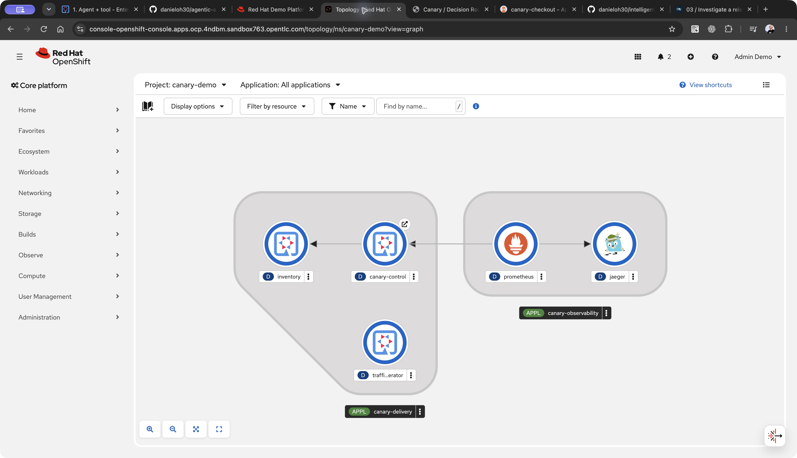
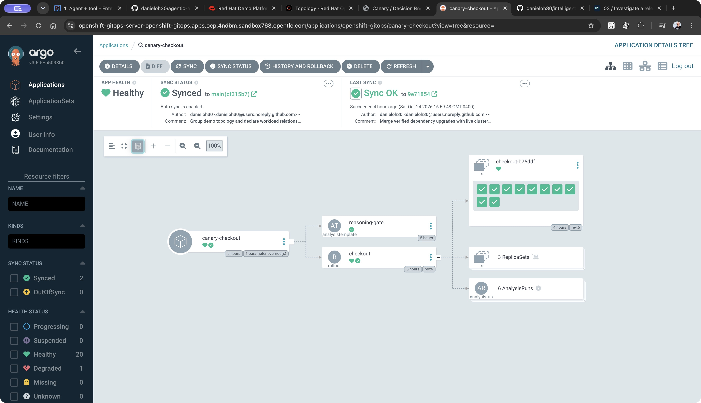

<div class="chapter-meta">02 / KUBERNETES INSTALLATION / OPENSHIFT 4.22</div>

# Connect the demo to Kubernetes

The application uses Kubernetes APIs and Argo resources. The installation script targets OpenShift 4.22, using its operator lifecycle, internal image registry, binary builds, and external Routes.

## 1. Prepare the cluster

Before running the installer, confirm:

- You can log in with `oc` as a cluster administrator.
- OperatorHub exposes the Red Hat OpenShift GitOps Operator.
- The image registry is enabled and has working storage.
- Builds and workloads can reach GitHub, Maven Central, Docker Hub, Quay, and the OpenAI API.
- At least **8 GiB of workload memory** is available as an initial planning allowance. Measure actual usage before presenting.

```bash
oc login YOUR_CLUSTER_API
oc whoami
oc get clusterversion version
```

!!! warning "Use a dedicated demo environment"
    The installer creates cluster-scoped GitOps components when they are absent. It reuses existing installations without changing their configuration. Existing Rollouts scope must be compatible with the `canary-demo` namespace.

## 2. Install

From your repository checkout:

```bash
export OPENAI_API_KEY='your-key'
export REPO_URL=https://github.com/danieloh30/intelligent-canary-delivery.git
./demo.sh install
```

Use your fork URL if you plan to commit releases from another repository. For a private repository, configure Argo CD credentials before expecting synchronization.

The script creates the dedicated **`canary-demo`** namespace. That namespace and the default **`openshift-gitops`** instance are currently fixed in the installer.

## 3. Understand the installation boundaries

The installer owns platform resources:

- The Quarkus control service, presenter SPA, inventory, and traffic generator.
- Scoped service accounts and observer roles.
- Prometheus, Jaeger, and the external dashboard Route.
- A Secret containing the model key and presenter token.

Argo CD owns release resources:

- The checkout `Rollout`.
- The shared `AnalysisTemplate` that calls the decision API.

The cluster build produces an immutable image digest. Platform deployments use that digest, and the Argo CD Application applies the same digest as a Kustomize image override. Changing a release version changes behavior and pod-template identity while keeping the verified application binary fixed.

Secrets pass through private temporary files and Kubernetes Secrets. They do not enter Git or the build context. The installer generates a portable GNU-format archive with Python so macOS metadata does not break the OpenShift source extractor.

## 4. Verify readiness

```bash
./demo.sh doctor
./demo.sh status
```

Check that the Argo CD Application is synchronized, the initial checkout release is healthy, and all workloads are ready. Confirm controller labels and log access; operator versions can use different labels.

[](../images/screenshots/09-topology.jpg)

*Recorded live cluster: identify `canary-delivery` and `canary-observability`, the runtime logos, and declared connections. The checkout Rollout may be absent from the console Topology view; it is visible in Argo CD. Click any screenshot to inspect the full-resolution image.*

[](../images/screenshots/10-argo-tree.jpg)

*Recorded live cluster after baseline recovery: point to Healthy, Synced, the Git revision, `reasoning-gate`, the checkout Rollout, and its ReplicaSets/AnalysisRuns. AnalysisRun history can contain previous failed canaries even while the current release is healthy. Your revision names and timestamps will differ.*


Retrieve the presenter token locally:

```bash
oc -n canary-demo get secret canary-secrets \
  -o jsonpath='{.data.api-token}' | base64 --decode
```

Open the HTTPS dashboard URL printed by the installer and enter that token.

!!! note "Installation success is not the end of rehearsal"
    The script checks resource creation and deployment availability. Validate traffic, canary analysis, OTLP export, real model calls, and recovery on your running cluster before taking the demo on stage. Local installer tests use an `oc` stub and cannot prove cluster admission or operator compatibility.

## 5. Inspect independent telemetry

Open a separate terminal for each port-forward:

```bash
oc -n canary-demo port-forward svc/jaeger 16686:16686
```

Jaeger is available at **http://localhost:16686**. Select checkout and follow a trace ID from an investigation.

```bash
oc -n canary-demo port-forward svc/prometheus 9090:9090
```

Prometheus is available at **http://localhost:9090**. Inspect `checkout_requests_total` and `checkout_dependency_attempts_total`. Pod discovery preserves revision labels and avoids counting the same pod through multiple Service aliases.

<div class="checkpoint" markdown>

### Checkpoint

You have a synchronized baseline, flowing synthetic traffic, available telemetry, and an authenticated presenter UI. You can distinguish installer-owned platform resources from Git-owned release resources.

</div>

Continue to [investigate a release](03-investigate.md).

## Open the dashboard through OpenShift SSO

Visit the dashboard Route directly or run `./demo.sh present` to open it alongside Argo CD. The installer configures an OpenShift OAuth proxy and presenter access for `DEMO_PRESENTER_USER` (the installing human user by default). Complete OpenShift login or first-use consent if prompted; an existing OpenShift session is reused. You do not enter or retrieve a presenter token for the OpenShift dashboard. The browser uses its SSO cookie, while the backend API credential remains inside the pod. Local development continues to use its separate development credential.

The installer also creates SSO-protected Prometheus and Jaeger Routes. Run `./demo.sh present --observability` to prepare all four demo tabs, or use `./demo.sh prometheus` and `./demo.sh jaeger`. Check `oc -n canary-demo get routes` for the current cluster addresses. Continue with the [metrics and traces walkthrough](../reference/observability.md) for the actual demo queries and trace-ID workflow.
