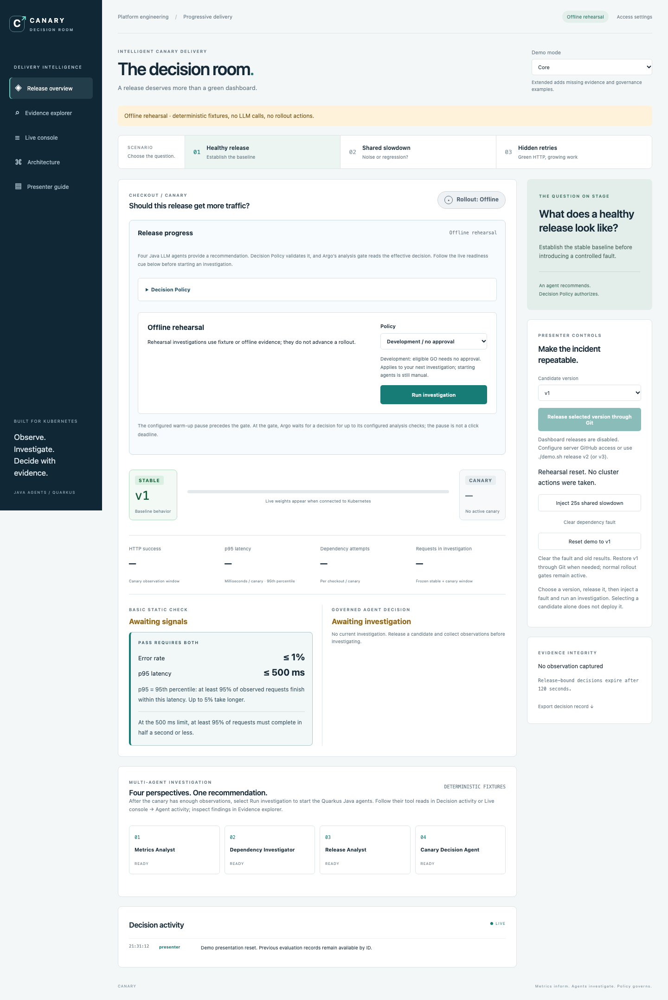
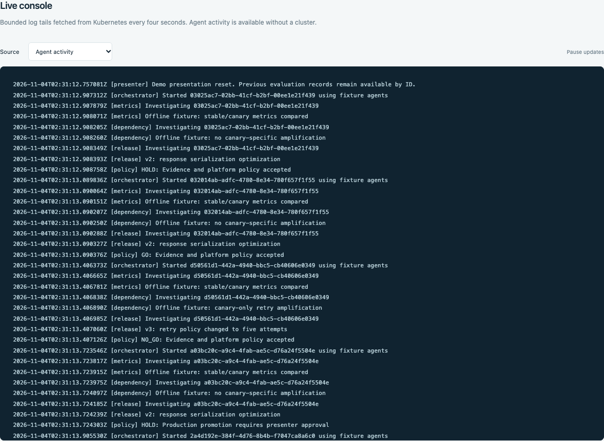
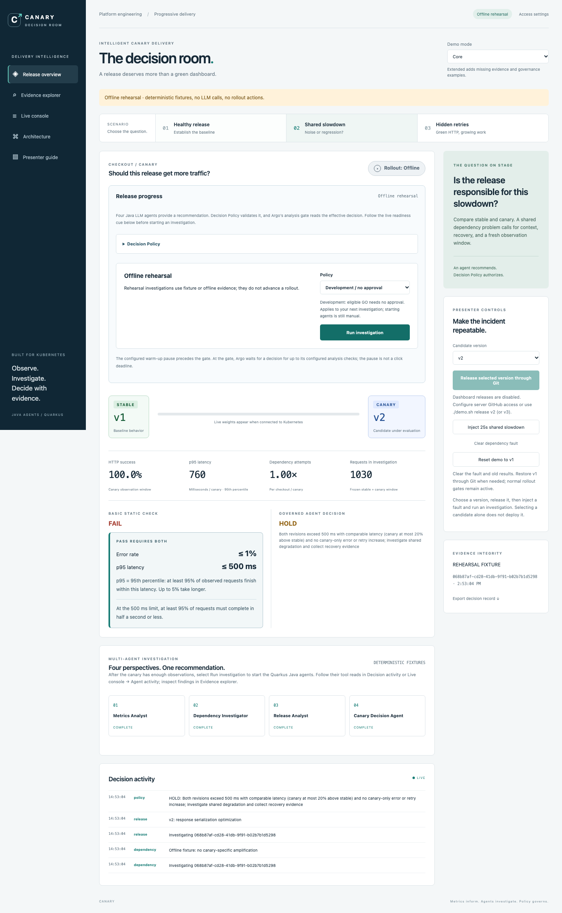
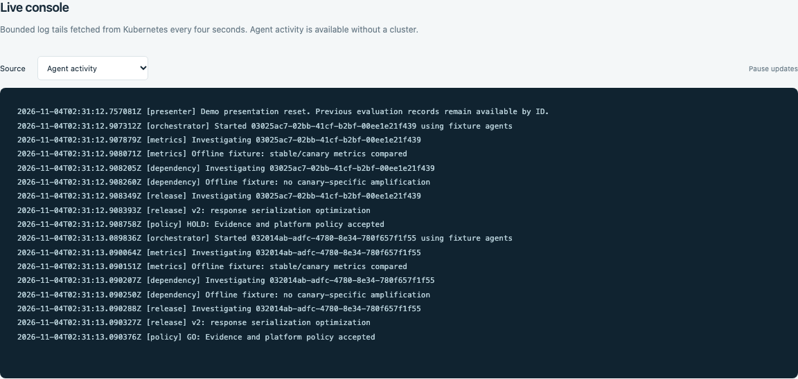
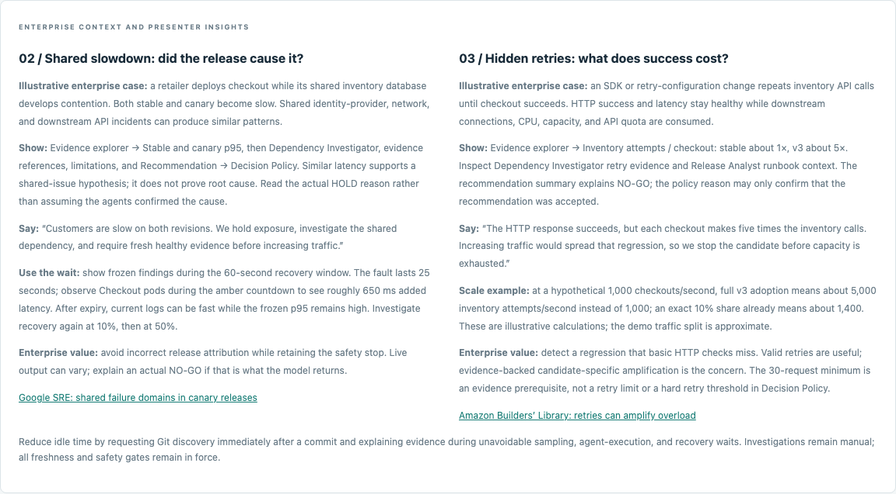
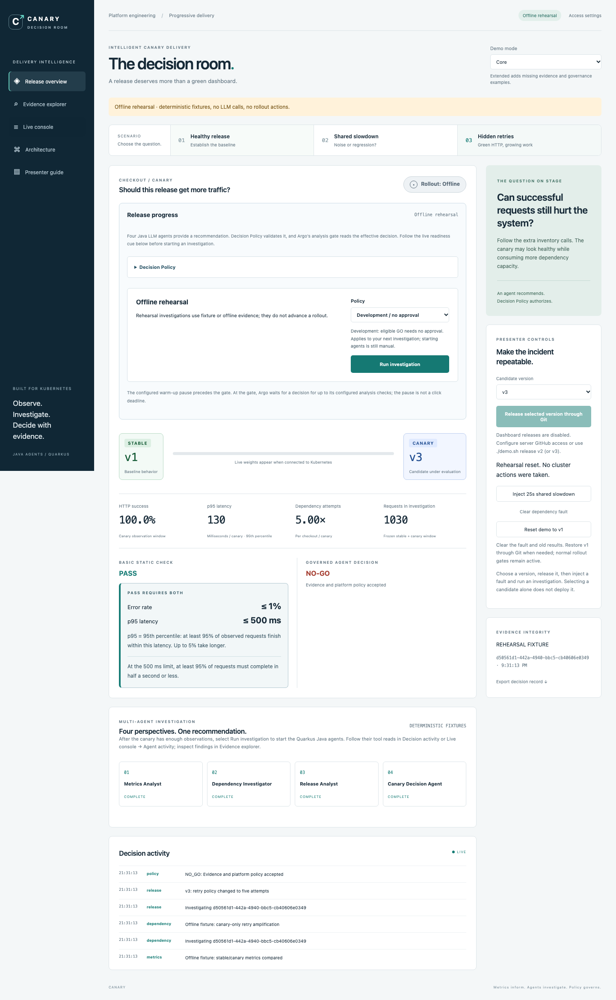
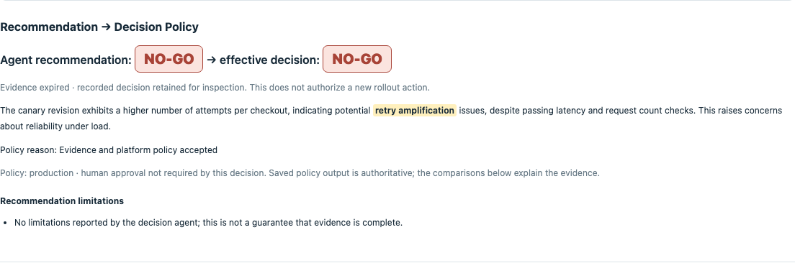
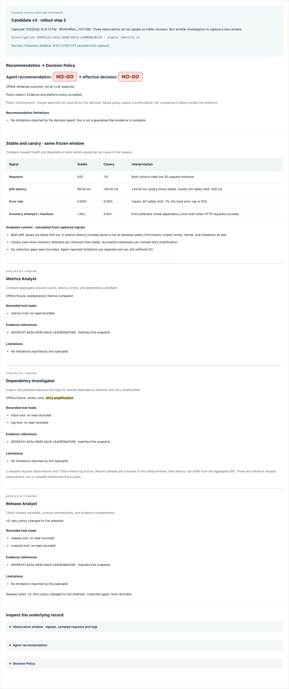

<div class="chapter-meta">03 / LIVE INVESTIGATION / TWO FAILURE PATTERNS</div>

# Investigate a release

Run two cases that challenge a basic HTTP threshold in opposite ways. The static check is a comparison shown in the UI. The governed agent decision controls the actual Argo analysis.

## 1. Establish a baseline

Before presenting, run `./demo.sh present --observability` once to prepare the dashboard, Argo CD, Prometheus, and Jaeger tabs. Complete OpenShift login if prompted. The release, fault injection, and investigation flow then stays in the dashboard.

Confirm v1 is stable in **Release overview** and inspect **Live console → Checkout pods** for flowing requests. `./demo.sh status` remains an optional terminal check.

!!! note "Checkout means an application operation"
    In this demo, **checkout** means a simulated shopping/order checkout: the application calls inventory to reserve an item. **Checkout pods** are the Kubernetes instances processing those requests. This is unrelated to `git checkout` or the GitHub Actions `actions/checkout` step that retrieves source code.

### Explain the flowing requests

The traffic generator continuously sends requests to the checkout application. In **Live console → Checkout pods**, point out the fields in a request log:

```text
INFO [checkout] traceId=... release=v1 attempts=1 success=true latencyMs=1.4
```

This is an illustrative line; trace IDs, timestamps, and latency vary on your cluster.

- **`release=v1`**: this request ran on the baseline application version.
- **`attempts=1`**: checkout called inventory once. This request did not amplify dependency traffic through retries.
- **`success=true`**: the checkout request completed successfully.
- **`latencyMs=1.4`**: this individual request completed in 1.4 milliseconds. Healthy baseline requests may take only a few milliseconds, but the exact value depends on the environment.
- **`traceId`**: use this identifier in Jaeger to follow the checkout request and its inventory calls; see the [trace walkthrough](../reference/observability.md).

!!! tip "Suggested presenter narration"
    “Our traffic generator is continuously sending checkout requests. Here, v1 completes successfully with one inventory call and low latency. This gives us a baseline to compare against when we introduce a slowdown or release v3 with hidden retries.”

Use **Healthy** in Release overview to confirm rollout health. These log lines demonstrate request activity and individual outcomes; a few successful requests do not establish the health of the entire observation window. The displayed p95 comes from the collected window, not a single log line.

### Restore a clean baseline

For a clean start, choose **Reset demo to v1** in Presenter controls. It clears the fault and current investigation. If v1 is already Healthy and stable, no new release is created. Otherwise reset commits a fresh v1 release through Git and the overview shows **Awaiting baseline**.

To verify that v1 is already the healthy stable baseline in **Release overview**, check all three indicators together:

- The prominent **green** badge in the checkout panel says **Rollout: Healthy**.
- The **green STABLE** label shows **v1**.
- The **neutral CANARY** label shows **—** and **No active canary**, indicating there is no separate active candidate.

The badge uses amber for paused/progressing rollouts, red for failures, and neutral gray when status is unavailable. Its rollout status is separate from the governed agent decision below.

After selecting Reset in that state, Presenter controls reports **“Fault cleared. Healthy v1 baseline retained; dashboard reset.”** This confirms that reset reused the baseline rather than creating another release. **Awaiting investigation** is the expected empty decision state; it does not indicate an unhealthy rollout. The Candidate version selector prepares the next action and is not proof of which version is currently deployed.

Recovery still uses the normal gates: keep candidate **v1** and Development policy, wait for at least 30 observations per revision at the 10% analysis stage, then select **Run investigation**. Repeat at the 50% analysis stage. A finished Inconclusive analysis needs a fresh reset/release before it can run again. Once the rollout is Healthy, select Reset again to clear recovery results without another rollout.

The clean starting screen shows **v1** stable, no active canary, empty metrics, and **Awaiting investigation**. This is expected: an initial screen has no release decision to show. Selecting v1 alone is not a reset, and an old v2 HOLD is not a current v1 verdict. Previous evaluations remain available by ID; active overview results are invalidated by releases, stage changes, and expiry.

Choose **Core** or **Extended** in the header. Extended adds Missing evidence; the presentation has no timer.

### Stable and canary in this demo

**Stable** is the last successfully promoted rollout revision, used as the reference while a candidate is evaluated. **Canary** is the candidate revision receiving a limited share of requests before promotion. Its identity card is blue while active and neutral when no separate canary exists. These identity colors distinguish roles; the rollout badge and collected evidence report health.

The normal release flow evaluates the canary at roughly 10% and 50% traffic before moving to 100%. Traffic proportions are approximated using pod counts. A GO permits the current analysis stage to pass; NO-GO fails the analysis and aborts the candidate, while HOLD withholds promotion. A fully promoted candidate becomes stable.

The traffic percentages are configured in `deploy/gitops/rollout.yaml`, under `spec.strategy.canary.steps`. The `setWeight: 10`, `setWeight: 50`, and `setWeight: 100` steps request each traffic stage. Analysis steps between them reference `reasoning-gate`. The definition in `deploy/gitops/analysis.yaml` specifies how to check the effective decision; it does not set traffic percentages.

Version names and rollout revisions are different: resetting can temporarily show v1 as both stable and canary because a fresh v1 pod template is being evaluated against the previous stable v1 revision. When that rollout becomes Healthy, the separate canary disappears.

The application has three prepared behaviors:

| Version | Checkout behavior | Purpose |
| --- | --- | --- |
| v1 | One inventory attempt | Stable reference |
| v2 | One inventory attempt | Healthy release under a shared slowdown |
| v3 | Repeated retryable inventory responses before success | Canary-specific dependency amplification |

The inventory fault is deliberately controlled. It makes the pattern reproducible without waiting for an uncontrolled outage.

<figure markdown>

[](../images/screenshots/01-baseline.png)

<figcaption>Current local rehearsal fixture after reset: Stable v1, no active canary, and Awaiting investigation. The Offline badge distinguishes this presentation view from a live Healthy rollout. This capture makes no LLM calls or cluster changes. Select the image for full resolution.</figcaption>
</figure>

## 2. Release v2 through Git

In the dashboard, choose **Shared slowdown**, confirm **Candidate version → v2**, and select **Release selected version through Git**. Follow the returned commit link to inspect the release diff.

The server commits the version, fresh release annotation, and analysis arguments in `deploy/gitops/rollout.yaml` to the configured GitHub branch, then requests an immediate Argo CD Application refresh. Argo CD discovers and reconciles the Git commit; the release API never patches the Rollout or skips an analysis gate. Selecting a candidate or scenario alone does not deploy it. After a new release is accepted, previous stage highlights clear while the SPA waits for GitOps reconciliation; the new 10% stage appears after the controllers observe the commit.

!!! tip "Reduce live-demo waiting"
    A successful dashboard release reports **Immediate Argo CD refresh requested**. Stay in the SPA while controller reconciliation, pod startup, and request sampling complete; a ten-second rollout is not guaranteed. The four-second SPA telemetry refresh is separate from Git discovery. If the refresh request fails, the Git commit remains successful and the SPA explains the automatic-sync fallback. Do not create another release just to refresh. Without a refresh request or webhook, Argo CD's documented default Git polling interval is 120 seconds plus up to 60 seconds of jitter; see the [Argo CD FAQ](https://argo-cd.readthedocs.io/en/stable/faq/#how-often-does-argo-cd-check-for-changes-to-my-git-or-helm-repository). Shell releases use normal Git discovery unless you request a refresh separately.

!!! note "Enable dashboard releases before presenting"
    Configure the server GitHub credential using the [cluster setup instructions](02-cluster.md#enable-releases-from-the-dashboard). Without it, the release button stays disabled and explains the shell alternative: `./demo.sh release v2`. The shell command requires a clean working tree; the dashboard writes directly to GitHub. Run `git pull --ff-only` before later editing or releasing from your local checkout.

Stay in **Release overview → Release progress**. The SPA now shows the complete stage sequence and the action to take:

1. **10% canary / Warm-up before analysis:** the configured 15-second pause is running. There is no need to click during this pause.
2. **Waiting for analysis readiness:** the analysis gate is active and the live rolling 60-second sample counts are filling. Check **Stable requests** and **Canary requests** separately; each needs at least **30**.
3. **Ready to investigate · 10% canary:** the cue turns green, and **Investigate v2 at 10%** becomes available. Select the policy beside that button first: **Development / no approval** for the core flow, or **Production / approval** for the Extended HITL demonstration. Then select the single stage-specific button to start the Java agents explicitly. Changing policy afterward does not modify that investigation.
4. After GO, watch the stage indicator advance to **50% canary**. Wait for the new green cue, then select **Investigate v2 at 50%**. The earlier stage's decision cannot authorize this stage.
5. Once the final gate passes, the panel reports **Release fully promoted**. The candidate becomes stable.

The live sample counts appear **before** any investigation. They are read-only observations refreshed every four seconds; they do not execute agents or make LLM calls. The metrics and **Requests in investigation** beneath the progress panel remain the frozen snapshot of the last applicable investigation. Readiness means the analysis gate and evidence are available; it does not guarantee a GO recommendation.

!!! note "The 15-second pause is not your click window"
    The pause precedes inline analysis. At the analysis gate, the rollout blocks while Argo polls the decision API. This demo configures **180 checks at five-second intervals**—roughly 15 minutes, plus execution overhead. These are HTTP checks of the saved policy result, not 180 seconds and not 180 LLM investigations. The SPA displays the AnalysisRun state and checks used so you can follow this without switching consoles.

If the gate finishes **Inconclusive**, the panel explains that a fresh release/reset is required and disables investigation for that completed run. It never bypasses a gate. Missing, stale, or unavailable progress also withholds the ready cue. Selecting a different candidate version disables the stage-specific action until it matches the active rollout.

Each Argo analysis gate consumes the result of a **four-agent Java/LLM investigation**, followed by deterministic **Decision Policy** validation. The gate polls the effective decision API; it does not run a single standalone agent or start another investigation on each poll.

Investigations are manual here to give the presenter control over fault injection and explanation. Each gate needs fresh evidence because traffic and dependency load change. An automated implementation could start an investigation on gate entry while retaining the same policy checks; refreshing this SPA does not do that.

!!! note "Traffic proportions are approximate"
    The demo uses replica proportions without a traffic-management provider. Ten replicas make 10% and 50% easy to explain, but the request share is not guaranteed to equal the replica share. The traffic generator closes each connection so new canary pods can receive requests.

For optional deeper inspection, open **canary-checkout** in the prepared Argo CD tab and identify its Git revision, Rollout, and AnalysisTemplate. Routine stage tracking, sample readiness, agent activity, and controller logs are available in the SPA.

## 3. Inject the shared slowdown

In the UI:

1. Choose **Shared slowdown** and candidate **v2**.
2. Select **Inject 25s shared slowdown**. An amber confirmation shows that the shared inventory fault is active, adds 650 ms per call, and has about 25 seconds remaining. Let affected checkout requests appear before investigating. The status explains when the fault expires or is cleared; affected requests remain in the rolling 60-second evidence window. A failed injection displays an error beside the button.
3. Select **Development / no approval** policy. After injection, the button shows **Waiting for slowdown evidence** until a fresh read shows p95 above 500 ms in **both** stable and canary, alongside at least 30 requests per cohort. Watch the new live p95 values beside the sample counts. Investigating immediately can capture an uneven window: a few slow canary requests may raise its p95 while the larger stable cohort still has a normal p95, making the release appear responsible. Once the green cue confirms **Shared slowdown observed**, select **Investigate v2 at 10%**. If the fault expires before both cohorts show it, re-inject or clear it to investigate recovery.

### Watch the Quarkus Java agents in the SPA

A release starts GitOps reconciliation. The four Java agents start when you select **Run investigation**; the AnalysisTemplate polls the resulting decision. No agent terminal is required.

- **Release overview:** follow the four agent cards and **Decision activity** for orchestrator events, evidence tool reads, and the policy verdict. The SPA polls activity every two seconds; short states can pass between updates.
- **Live console → Agent activity:** follow the same bounded event history as text.
- **Live console → Quarkus control plane:** inspect actual Java pod logs, refreshed every four seconds. Switch to **Argo Rollouts controller** or **Argo CD controller** to follow deployment actions.
- **Evidence explorer:** inspect **Numerical consistency review** if a model confuses the thresholds. Tools provide exact comparisons such as **7.8 ms ≤ 500 ms** and **58 requests ≥ 30**. The application permits one correction against the same frozen evidence and retains both reports, without extending its deadline or tool budget. It never forces GO from passing numbers alone. If the investigation fails before returning findings, inspect **Agent execution diagnostics** for the safe error category and exception types. This differs from an evidence-based HOLD; clearing an application fault or waiting for traffic does not repair model execution. A recoverable failure gets at most one automatic retry within the original budget. If it still fails, retry at the same active gate. Retry-budget phrases and the stable/canary attempt comparison are highlighted. Then compare stable and canary request counts, p95, errors, and inventory attempts in the frozen window. Read the calculated context, then each specialist’s summary, recorded tool reads, evidence references, and limitations. Compare the agent recommendation with the effective Decision Policy result and its reason. Expand the raw observation, recommendation, and policy records for deeper inspection. Expired or historical decisions are labeled; recent request samples are only a subset of the aggregate window. Reloading retains the selected page and scenario in the same browser tab.

[](../images/screenshots/13-agent-activity.png)

*Local rehearsal fixture events in Live console. This illustrates where presenter activity and policy events appear; it is not a live LLM trace.*

The agents execute in one Quarkus service: Metrics Analyst first, Dependency Investigator and Release Analyst concurrently, then Canary Decision Agent. Tool reads appear during execution; specialist findings are published when the workflow completes. These views expose recorded activity and structured outputs, not private model reasoning.

Both revisions should show increased inventory latency. The basic static check fails while the agents investigate whether the candidate caused the change. In the highlighted **PASS REQUIRES BOTH** panel, the limits are **error rate ≤ 1%** and **p95 latency ≤ 500 ms**. p95 means the 95th percentile: at least 95% of observed requests finish within that latency, and up to 5% take longer. At this limit, at least 95% must finish within half a second.

During the affected-window wait, switch to the prepared Prometheus tab and compare success, mean latency, and dependency attempts across release/revision labels. Use the [copyable observability queries](../reference/observability.md); Prometheus mean latency and the SPA p95 are different statistics.

The appropriate initial result for a represented shared slowdown is **HOLD**. Decision Policy explicitly withholds promotion when both p95 values exceed 500 ms, canary p95 is at most 20% above stable, and canary errors and attempts per checkout do not exceed stable. This is a documented demo heuristic, not proof of root cause. The original model recommendation remains visible even if the policy changes NO-GO to effective HOLD. Candidate-specific retries, increased errors, materially worse latency, and the hard error cap remain rejectable. A known dependency cause does not make ongoing customer degradation safe.

### Enterprise context: avoid incorrect release attribution

**Illustrative case:** a retailer releases a new checkout version while its shared inventory database develops contention. Both stable and canary become slow. A similar pattern can arise from a degraded identity provider, shared network path, or downstream API.

A fixed 500 ms limit detects customer degradation but cannot establish whether the candidate caused it. Comparing both cohorts helps distinguish shared conditions from a candidate-specific regression. Similar latency is evidence consistent with a shared issue, not proof of root cause; inspect dependency observations, release context, and limitations. Google describes how shared backends and failure domains complicate canary evaluation in [Canarying Releases](https://sre.google/workbook/canarying-releases/).

**Show the audience:** open **Evidence explorer → Stable and canary** and compare p95 in the same frozen window. Then show **Dependency Investigator**, its evidence references and limitations, and **Recommendation → Decision Policy**. Read the actual policy reason: HOLD for unresolved limitations is different from a confirmed shared-cause finding. Live LLM output can vary; if it returns NO-GO, show the saved explanation rather than claiming the intended HOLD occurred.

**Presenter line:** “Customers are slow on both revisions. We hold exposure, investigate the shared dependency, and require fresh healthy evidence before increasing traffic.” The enterprise value is avoiding an unsupported rollback diagnosis while retaining a safety stop. HOLD does not mean that ongoing degradation is acceptable.

**Use the recovery wait:** explain the frozen evidence and specialist findings while affected requests drain from the rolling 60-second window. The injected fault lasts 25 seconds; checkout logs return to normal after expiry, while slow observations can remain in the evidence window. Reinvestigate recovery at 10%, then use a fresh investigation at 50%.


<figure markdown>

[](../images/screenshots/02-shared-hold.png)

<figcaption>Local rehearsal fixture: the shared slowdown fails the basic latency check and produces HOLD. The capture demonstrates the decision flow without making live model calls. Select the image for full resolution.</figcaption>
</figure>

Clear the fault, let affected observations drain from the **60-second window**, and investigate again. A healthy, sufficiently sampled observation can produce GO. In the Argo CD tab, show the Successful AnalysisRun and progression to the next stage. Repeat the evaluation when Release progress shows **Ready to investigate · 50% canary**; a decision cannot authorize a different stage.

<figure markdown>

[](../images/screenshots/03-recovered-go.png)

<figcaption>Local rehearsal fixture: a healthy observation produces GO under Development policy. This illustrates the recovered state; a live rollout requires a fresh cluster investigation at its current stage. Select the image for full resolution.</figcaption>
</figure>

<figure markdown>

[](../images/screenshots/07-recovered-activity.png)

<figcaption>Current local rehearsal Agent activity: the policy event changes from HOLD to GO after a fresh healthy investigation. These fixture events demonstrate the SPA view; they are not live LLM execution or a Successful AnalysisRun. Select the image for full resolution.</figcaption>
</figure>

## 4. Release the retry regression

After the healthy release settles, choose **Hidden retries**, confirm candidate **v3**, and select **Release selected version through Git**.

Watch Release progress for the active analysis gate and the green **Ready to investigate** cue, with at least 30 live observations for both revisions. Select the stage-specific **Investigate v3** action , and follow the Java agents in the same SPA views. The optional shell equivalent is `./demo.sh release v3`.

The expected evidence pattern is:

- HTTP success remains high.
- Latency stays within the basic 500 ms limit.
- Canary inventory attempts per checkout rise relative to stable.
- Trace-linked observations and logs show repeated attempts for the candidate.

The specialists retrieve metrics, request observations, retry records, release metadata, and operational guidance. The decision agent should recommend **NO-GO** for the canary-specific regression. Inspect the actual evidence and response rather than assuming the model will always produce the desired answer.

### Enterprise context: expose successful requests that amplify dependency load

**Illustrative case:** a new SDK or retry configuration causes repeated inventory API calls before a checkout eventually succeeds. Customer HTTP success and latency can look healthy while the candidate consumes extra downstream connections, CPU, capacity, or API quota. Amazon explains how retries can amplify load and worsen an overloaded dependency in [Timeouts, retries, and backoff with jitter](https://aws.amazon.com/builders-library/timeouts-retries-and-backoff-with-jitter/).

In this demo, stable uses **one inventory attempt per checkout**; v3 receives four retryable failures before succeeding on its **fifth attempt**. This is dependency work per business operation, not an unusually large customer request count. At a hypothetical 1,000 checkouts/second, full v3 adoption would produce about 5,000 inventory attempts/second instead of 1,000. If exactly 10% of those checkouts used v3, total attempts would already rise to about 1,400/second. These are illustrative calculations, not measured cluster throughput; the demo's traffic split is approximate.

**Show the audience:** in **Evidence explorer**, compare **Inventory attempts / checkout** across stable and canary. Show the **Dependency Investigator** retry evidence, **Release Analyst** runbook context, then the recommendation summary explaining NO-GO. The policy reason may simply say the recommendation was accepted; the detailed rationale is in the agent recommendation and specialist findings.

**Presenter line:** “The HTTP response succeeds, but each checkout makes five times the inventory calls. Increasing traffic would spread that regression, so we stop the candidate before capacity is exhausted.” Valid retries are not inherently a defect; the concern is evidence-backed candidate-specific amplification. The 30-request minimum is an evidence prerequisite, not a retry limit. Live agents interpret the evidence. Decision Policy also enforces an explicit demo retry safety budget: NO-GO when canary attempts per checkout exceed 2 AND exceed twice stable, corroborated by a sampled retrying canary request and its trace-linked log. Both profiles apply this rule; Production approval only applies to otherwise eligible GO. Missing/stale evidence or insufficient samples still means HOLD.

Together, scenario 02 demonstrates **avoiding incorrect release attribution**, while scenario 03 demonstrates **detecting a regression that basic HTTP checks miss**. Inspect the actual recommendation, effective policy decision, and controller outcome separately.

[](../images/screenshots/11-enterprise-guide.png)

*Current Presenter guide: enterprise examples, evidence to show, sample presenter lines, and useful discussion during sampling and recovery waits. The throughput calculations are illustrative, not a cluster benchmark.*


<figure markdown>

[](../images/screenshots/04-retry-no-go.png)

<figcaption>Local rehearsal fixture: HTTP checks pass while dependency amplification supports NO-GO. These are deterministic demonstration results, not live LLM output. Select the image for full resolution.</figcaption>
</figure>

Argo Rollouts should abort the candidate. Switch to Argo CD and open the Failed AnalysisRun. During that failed rollout, inspect the aborted/degraded Rollout and the stable ReplicaSet retaining service. Confirm the same outcome in the SPA and live logs. Explain that Argo CD can remain Synced while Rollout health is Degraded: Git reconciliation and release health are different signals. After a reset, the current application can be Healthy while the Failed AnalysisRun remains in history.

<figure markdown>

[](../images/screenshots/08-recorded-decision.png)

<figcaption>Recorded live agent/policy output captured on 2026-11-04 UTC, rendered in the current SPA. Both NO-GO verdicts are highlighted; the recommendation identifies retry amplification. Expiry is shown separately because the rejected rollout outcome remains historical evidence. Production approval does not override NO-GO. No new investigation was run for this image. Select the image for full resolution.</figcaption>
</figure>

## 5. Explain the evidence

Open **Evidence explorer** and identify:

1. The exact release and observation time.
2. Sample counts for each revision.
3. Dependency attempts per checkout.
4. Correlated trace IDs and retry records.
5. The specialist findings and final recommendation.
6. The independent Decision Policy decision.

The trace tool exposes request summaries with real OTel trace IDs. Switch to the prepared Jaeger tab and use a recent trace ID to open the complete trace tree. Follow `inventory.reserve` spans and the `retry.attempt` attributes; see the [metrics and traces walkthrough](../reference/observability.md). The agent log tool reads bounded request records; the Live Console separately retrieves actual pod logs.

<figure markdown>

[](../images/screenshots/05-evidence.png)

<figcaption>Local rehearsal fixture: inspect the source label, observation window, findings, and policy result. Fixture identifiers are illustrative; use the live investigation's trace IDs when opening Jaeger on Kubernetes. Select the image for full resolution.</figcaption>
</figure>

!!! tip "A fair comparison"
    A deterministic dependency-amplification rule could detect this regression too. The demonstration teaches evidence selection, follow-up investigation, uncertainty, and a reusable policy contract. It does not claim every failure requires an LLM.

<div class="checkpoint" markdown>

### Checkpoint

You can explain why a shared slowdown initially calls for HOLD, why successful requests can conceal a retry regression, and how a recommendation becomes an actual rollout outcome.

</div>

Continue to [govern the decision](04-govern.md).

### Returning to v1 after the scenarios

Use **Reset demo to v1** to clear the fault and presentation state and select Healthy release with Development policy. Alternatively, a successful **Release selected version through Git → v1** now selects Healthy release automatically, preventing the previous Missing evidence scenario from withholding traces during baseline recovery. The selected candidate persists across browser reloads. A normal Git release preserves your policy selection; choose Development / no approval for baseline recovery. Investigate once the v1 candidate is ready at 10%, then again at 50%. These are fresh safety gates, not an automatic bypass.
