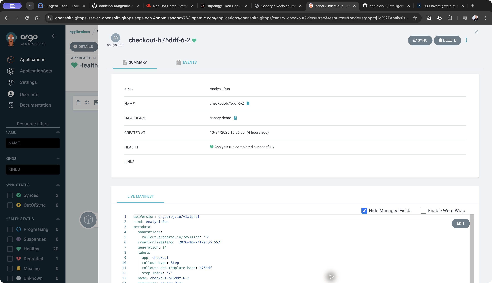
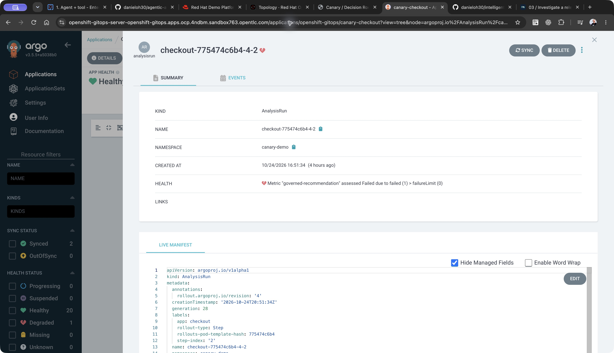

<div class="chapter-meta">03 / LIVE INVESTIGATION / TWO FAILURE PATTERNS</div>

# Investigate a release

Run two cases that challenge a basic HTTP threshold in opposite ways. The static check is a comparison shown in the UI. The governed agent decision controls the actual Argo analysis.

## 1. Establish a baseline

Before presenting, run `./demo.sh present --observability` once to prepare the dashboard, Argo CD, Prometheus, and Jaeger tabs. Complete OpenShift login if prompted. The release, fault injection, and investigation flow then stays in the dashboard.

Confirm v1 is stable in **Release overview** and inspect **Live console → Checkout pods** for flowing requests. `./demo.sh status` remains an optional terminal check.

!!! note "Checkout means an application operation"
    In this demo, **checkout** means a simulated shopping/order checkout: the application calls inventory to reserve an item. **Checkout pods** are the Kubernetes instances processing those requests. This is unrelated to `git checkout` or the GitHub Actions `actions/checkout` step that retrieves source code.

### Explain the flowing requests

The traffic generator continuously sends requests to the checkout application. In **Live console → Checkout pods**, point out the fields in a request log:

```text
INFO [checkout] traceId=... release=v1 attempts=1 success=true latencyMs=1.4
```

This is an illustrative line; trace IDs, timestamps, and latency vary on your cluster.

- **`release=v1`**: this request ran on the baseline application version.
- **`attempts=1`**: checkout called inventory once. This request did not amplify dependency traffic through retries.
- **`success=true`**: the checkout request completed successfully.
- **`latencyMs=1.4`**: this individual request completed in 1.4 milliseconds. Healthy baseline requests may take only a few milliseconds, but the exact value depends on the environment.
- **`traceId`**: use this identifier in Jaeger to follow the checkout request and its inventory calls; see the [trace walkthrough](../reference/observability.md).

!!! tip "Suggested presenter narration"
    “Our traffic generator is continuously sending checkout requests. Here, v1 completes successfully with one inventory call and low latency. This gives us a baseline to compare against when we introduce a slowdown or release v3 with hidden retries.”

Use **Healthy** in Release overview to confirm rollout health. These log lines demonstrate request activity and individual outcomes; a few successful requests do not establish the health of the entire observation window. The displayed p95 comes from the collected window, not a single log line.

### Restore a clean baseline

For a clean start, choose **Reset demo to v1** in Presenter controls. It clears the fault and current investigation. If v1 is already Healthy and stable, no new release is created. Otherwise reset commits a fresh v1 release through Git and the overview shows **Awaiting baseline**.

To verify that v1 is already the healthy stable baseline in **Release overview**, check all three indicators together:

- The rollout badge in the checkout panel says **Healthy**.
- **STABLE** shows **v1**.
- **CANARY** shows **—**, indicating there is no separate active candidate.

After selecting Reset in that state, Presenter controls reports **“Fault cleared. Healthy v1 baseline retained; dashboard reset.”** This confirms that reset reused the baseline rather than creating another release. **Awaiting investigation** is the expected empty decision state; it does not indicate an unhealthy rollout. The Candidate version selector prepares the next action and is not proof of which version is currently deployed.

Recovery still uses the normal gates: keep candidate **v1** and Development policy, wait for at least 30 observations per revision at the 10% analysis stage, then select **Run investigation**. Repeat at the 50% analysis stage. A finished Inconclusive analysis needs a fresh reset/release before it can run again. Once the rollout is Healthy, select Reset again to clear recovery results without another rollout.

The clean starting screen shows **v1** stable, no active canary, empty metrics, and **Awaiting investigation**. This is expected: an initial screen has no release decision to show. Selecting v1 alone is not a reset, and an old v2 HOLD is not a current v1 verdict. Previous evaluations remain available by ID; active overview results are invalidated by releases, stage changes, and expiry.

Choose **Core** or **Extended** in the header. Extended adds Missing evidence; the presentation has no timer.

The application has three prepared behaviors:

| Version | Checkout behavior | Purpose |
| --- | --- | --- |
| v1 | One inventory attempt | Stable reference |
| v2 | One inventory attempt | Healthy release under a shared slowdown |
| v3 | Repeated retryable inventory responses before success | Canary-specific dependency amplification |

The inventory fault is deliberately controlled. It makes the pattern reproducible without waiting for an uncontrolled outage.

<figure markdown>

[](../images/screenshots/01-baseline.png)

<figcaption>Local rehearsal fixture: establish the baseline before injecting a fault. This SPA capture uses deterministic fixtures, not a live LLM or a live Kubernetes rollout. Select the image for full resolution.</figcaption>
</figure>

## 2. Release v2 through Git

In the dashboard, choose **Shared slowdown**, confirm **Candidate version → v2**, and select **Release selected version through Git**. Follow the returned commit link to inspect the release diff.

The server commits the version, fresh release annotation, and analysis arguments in `deploy/gitops/rollout.yaml` to the configured GitHub branch. Argo CD reconciles that commit. Selecting a candidate or scenario alone does not deploy it.

!!! note "Enable dashboard releases before presenting"
    Configure the server GitHub credential using the [cluster setup instructions](02-cluster.md#enable-releases-from-the-dashboard). Without it, the release button stays disabled and explains the shell alternative: `./demo.sh release v2`. The shell command requires a clean working tree; the dashboard writes directly to GitHub. Run `git pull --ff-only` before later editing or releasing from your local checkout.

Wait until the **10% analysis step** is running and both revisions have at least **30 request observations**. Run an investigation after the step begins so its evidence matches the current stage.

!!! note "Traffic proportions are approximate"
    The demo uses replica proportions without a traffic-management provider. Ten replicas make 10% and 50% easy to explain, but the request share is not guaranteed to equal the replica share. The traffic generator closes each connection so new canary pods can receive requests.

In the prepared Argo CD tab, open **canary-checkout**. Point out its Git revision and resource tree, including the Rollout and AnalysisTemplate. Return to the dashboard to continue.

## 3. Inject the shared slowdown

In the UI:

1. Choose **Shared slowdown** and candidate **v2**.
2. Select **Inject 25s shared slowdown**.
3. Select **Development / automatic** policy and **Run investigation**.

### Watch the Quarkus Java agents in the SPA

A release starts GitOps reconciliation. The four Java agents start when you select **Run investigation**; the AnalysisTemplate polls the resulting decision. No agent terminal is required.

- **Release overview:** follow the four agent cards and **Decision activity** for orchestrator events, evidence tool reads, and the policy verdict. The SPA polls activity every two seconds; short states can pass between updates.
- **Live console → Agent activity:** follow the same bounded event history as text.
- **Live console → Quarkus control plane:** inspect actual Java pod logs, refreshed every four seconds. Switch to **Argo Rollouts controller** or **Argo CD controller** to follow deployment actions.
- **Evidence explorer:** after completion, inspect the three specialist findings, final recommendation, frozen evidence, and independent Java policy result.

The agents execute in one Quarkus service: Metrics Analyst first, Dependency Investigator and Release Analyst concurrently, then Canary Decision Agent. Tool reads appear during execution; specialist findings are published when the workflow completes. These views expose recorded activity and structured outputs, not private model reasoning.

Both revisions should show increased inventory latency. The basic static check fails while the agents investigate whether the candidate caused the change.

During the affected-window wait, switch to the prepared Prometheus tab and compare success, mean latency, and dependency attempts across release/revision labels. Use the [copyable observability queries](../reference/observability.md); Prometheus mean latency and the SPA p95 are different statistics.

The appropriate initial result is **HOLD**. A known dependency cause does not make ongoing customer degradation safe.

<figure markdown>

[](../images/screenshots/02-shared-hold.png)

<figcaption>Local rehearsal fixture: the shared slowdown fails the basic latency check and produces HOLD. The capture demonstrates the decision flow without making live model calls. Select the image for full resolution.</figcaption>
</figure>

Clear the fault, let affected observations drain from the **60-second window**, and investigate again. A healthy, sufficiently sampled observation can produce GO. In the Argo CD tab, show the Successful AnalysisRun and progression to the next stage. Repeat the evaluation when the rollout reaches its 50% analysis stage; a decision cannot authorize a different stage.

<figure markdown>

[](../images/screenshots/03-recovered-go.png)

<figcaption>Local rehearsal fixture: a healthy observation produces GO under Development policy. This illustrates the recovered state; a live rollout requires a fresh cluster investigation at its current stage. Select the image for full resolution.</figcaption>
</figure>

<figure markdown>

[](../images/screenshots/07-argo-success.jpg)

<figcaption>Recorded live-cluster evidence: a Successful AnalysisRun from the Kubernetes rehearsal. Inspect its metric measurement for GO. AnalysisRun names and retained history vary between rehearsals. Select the image for full resolution.</figcaption>
</figure>

## 4. Release the retry regression

After the healthy release settles, choose **Hidden retries**, confirm candidate **v3**, and select **Release selected version through Git**.

Wait for the new canary, its current analysis stage, and at least 30 observations per revision. Select **Run investigation** and follow the Java agents in the same SPA views. The optional shell equivalent is `./demo.sh release v3`.

The expected evidence pattern is:

- HTTP success remains high.
- Latency stays within the basic 500 ms limit.
- Canary inventory attempts per checkout rise relative to stable.
- Trace-linked observations and logs show repeated attempts for the candidate.

The specialists retrieve metrics, request observations, retry records, release metadata, and operational guidance. The decision agent should recommend **NO-GO** for the canary-specific regression. Inspect the actual evidence and response rather than assuming the model will always produce the desired answer.

<figure markdown>

[](../images/screenshots/04-retry-no-go.png)

<figcaption>Local rehearsal fixture: HTTP checks pass while dependency amplification supports NO-GO. These are deterministic demonstration results, not live LLM output. Select the image for full resolution.</figcaption>
</figure>

Argo Rollouts should abort the candidate. Switch to Argo CD and open the Failed AnalysisRun. During that failed rollout, inspect the aborted/degraded Rollout and the stable ReplicaSet retaining service. Confirm the same outcome in the SPA and live logs. Explain that Argo CD can remain Synced while Rollout health is Degraded: Git reconciliation and release health are different signals. After a reset, the current application can be Healthy while the Failed AnalysisRun remains in history.

<figure markdown>

[](../images/screenshots/08-argo-failed.jpg)

<figcaption>Recorded live-cluster evidence: a Failed AnalysisRun from the retry rehearsal. Inspect its metric measurement for NO_GO. This is retained run history, not a claim that the current application is degraded; resource names vary. Select the image for full resolution.</figcaption>
</figure>

## 5. Explain the evidence

Open **Evidence explorer** and identify:

1. The exact release and observation time.
2. Sample counts for each revision.
3. Dependency attempts per checkout.
4. Correlated trace IDs and retry records.
5. The specialist findings and final recommendation.
6. The independent Java policy decision.

The trace tool exposes request summaries with real OTel trace IDs. Switch to the prepared Jaeger tab and use a recent trace ID to open the complete trace tree. Follow `inventory.reserve` spans and the `retry.attempt` attributes; see the [metrics and traces walkthrough](../reference/observability.md). The agent log tool reads bounded request records; the Live Console separately retrieves actual pod logs.

<figure markdown>

[](../images/screenshots/05-evidence.png)

<figcaption>Local rehearsal fixture: inspect the source label, observation window, findings, and policy result. Fixture identifiers are illustrative; use the live investigation's trace IDs when opening Jaeger on Kubernetes. Select the image for full resolution.</figcaption>
</figure>

!!! tip "A fair comparison"
    A deterministic dependency-amplification rule could detect this regression too. The demonstration teaches evidence selection, follow-up investigation, uncertainty, and a reusable policy contract. It does not claim every failure requires an LLM.

<div class="checkpoint" markdown>

### Checkpoint

You can explain why a shared slowdown initially calls for HOLD, why successful requests can conceal a retry regression, and how a recommendation becomes an actual rollout outcome.

</div>

Continue to [govern the decision](04-govern.md).
