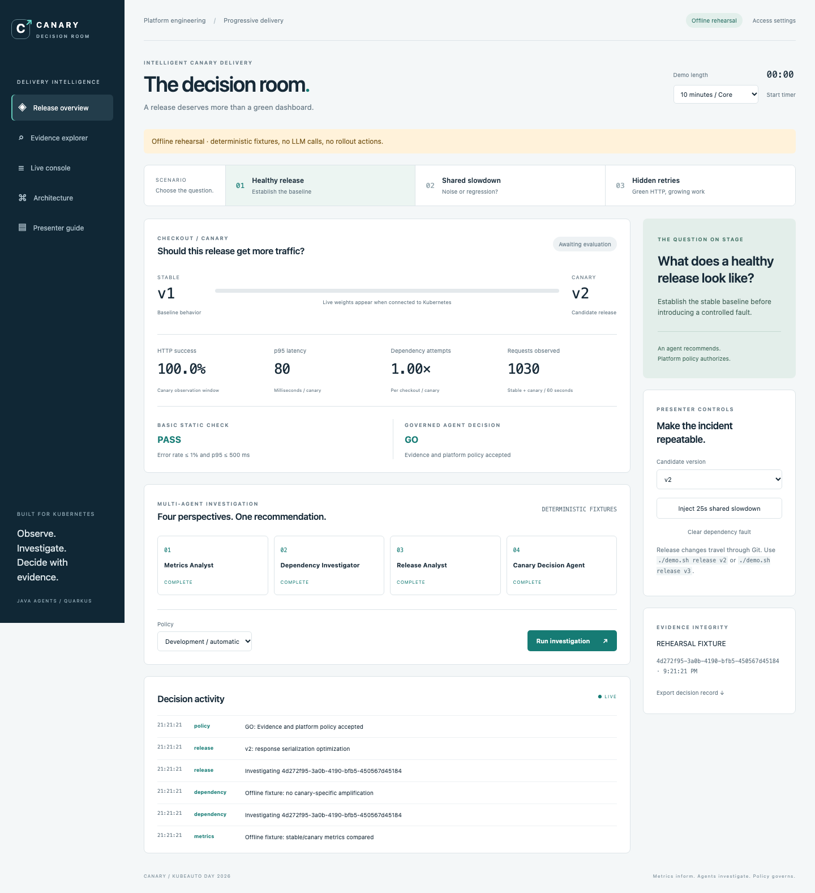
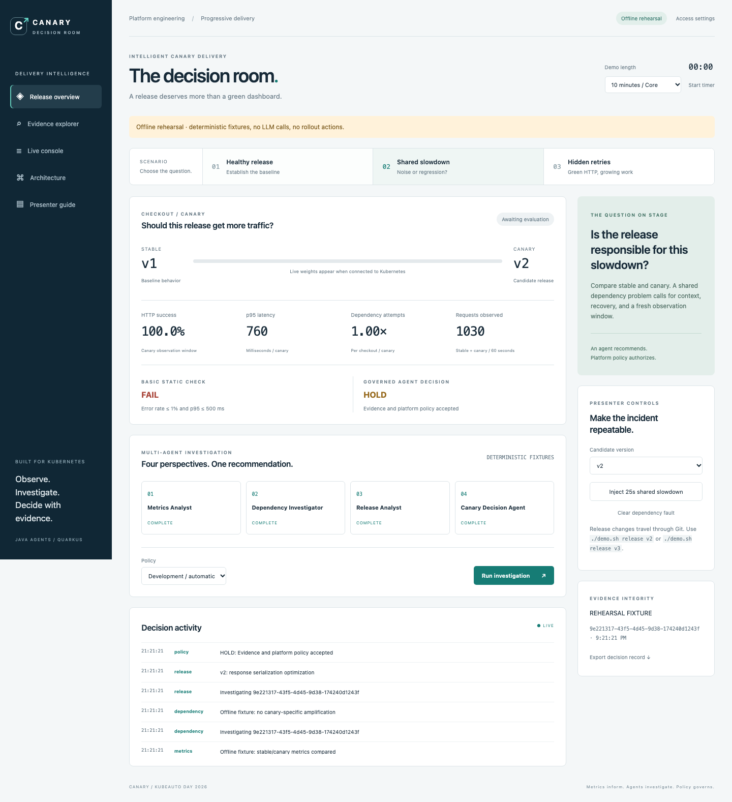
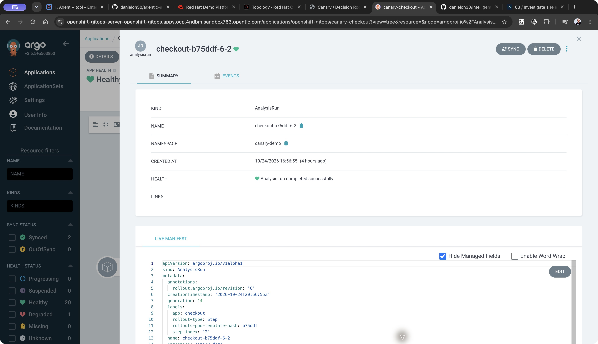
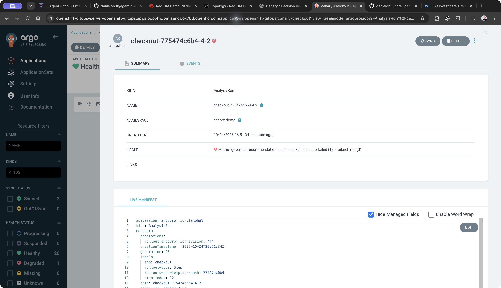
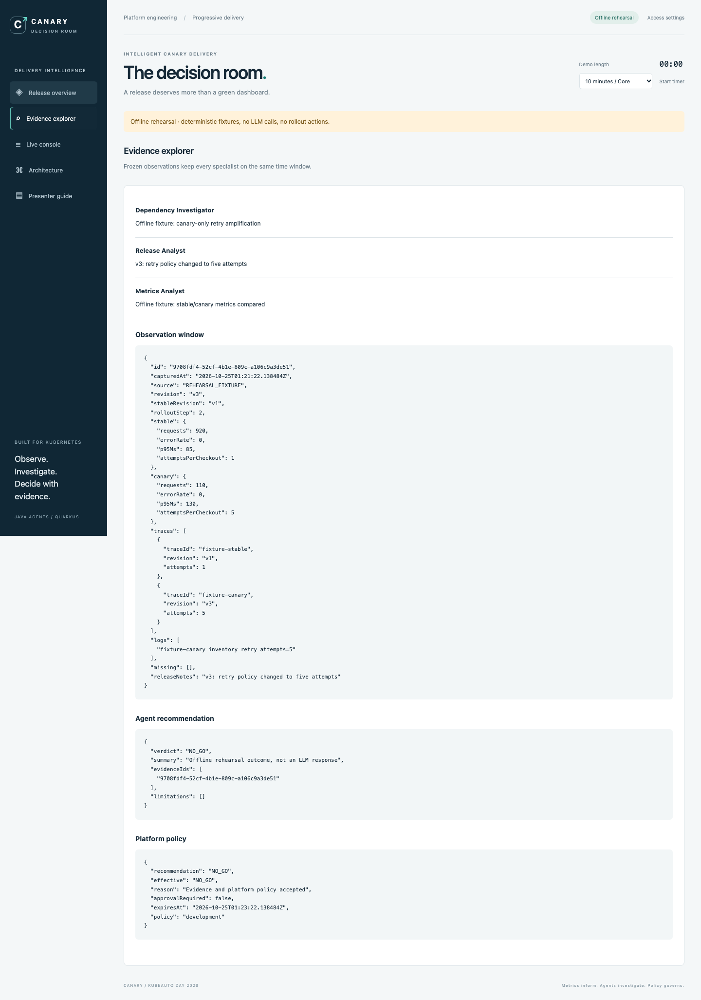

<div class="chapter-meta">03 / LIVE INVESTIGATION / TWO FAILURE PATTERNS</div>

# Investigate a release

Run two cases that challenge a basic HTTP threshold in opposite ways. The static check is a comparison shown in the UI. The governed agent decision controls the actual Argo analysis.

## 1. Establish a baseline

Confirm v1 is stable and the traffic generator is running:

```bash
./demo.sh status
```

The application has three prepared behaviors:

| Version | Checkout behavior | Purpose |
| --- | --- | --- |
| v1 | One inventory attempt | Stable reference |
| v2 | One inventory attempt | Healthy release under a shared slowdown |
| v3 | Repeated retryable inventory responses before success | Canary-specific dependency amplification |

The inventory fault is deliberately controlled. It makes the pattern reproducible without waiting for an uncontrolled outage.

<figure markdown>

[](../images/screenshots/01-baseline.png)

<figcaption>Local rehearsal fixture: establish the baseline before injecting a fault. This SPA capture uses deterministic fixtures, not a live LLM or a live Kubernetes rollout. Select the image for full resolution.</figcaption>
</figure>

## 2. Release v2 through Git

```bash
./demo.sh release v2
```

This command requires a clean working tree. It changes the version and release annotation in the rollout manifest, commits the change, and pushes it. Argo CD reconciles the new desired state.

Wait until the **10% analysis step** is running and both revisions have at least **30 request observations**. Run an investigation after the step begins so its evidence matches the current stage.

!!! note "Traffic proportions are approximate"
    The demo uses replica proportions without a traffic-management provider. Ten replicas make 10% and 50% easy to explain, but the request share is not guaranteed to equal the replica share. The traffic generator closes each connection so new canary pods can receive requests.

Before injecting faults, run `./demo.sh argo`, log in via OpenShift, and open **canary-checkout**. Point out its Git revision and resource tree, including the Rollout and AnalysisTemplate. Keep this tab open.

## 3. Inject the shared slowdown

In the UI:

1. Choose **Shared slowdown** and candidate **v2**.
2. Select **Inject 25s shared slowdown**.
3. Run an investigation under Development policy.

Both revisions should show increased inventory latency. The basic static check fails while the agents investigate whether the candidate caused the change.

During the affected-window wait, open Prometheus with `./demo.sh prometheus` and compare success, mean latency, and dependency attempts across release/revision labels. Use the [copyable observability queries](../reference/observability.md); Prometheus mean latency and the SPA p95 are different statistics.

The appropriate initial result is **HOLD**. A known dependency cause does not make ongoing customer degradation safe.

<figure markdown>

[](../images/screenshots/02-shared-hold.png)

<figcaption>Local rehearsal fixture: the shared slowdown fails the basic latency check and produces HOLD. The capture demonstrates the decision flow without making live model calls. Select the image for full resolution.</figcaption>
</figure>

Clear the fault, let affected observations drain from the **60-second window**, and investigate again. A healthy, sufficiently sampled observation can produce GO. In the Argo CD tab, show the Successful AnalysisRun and progression to the next stage. Repeat the evaluation when the rollout reaches its 50% analysis stage; a decision cannot authorize a different stage.

<figure markdown>

[](../images/screenshots/03-recovered-go.png)

<figcaption>Local rehearsal fixture: a healthy observation produces GO under Development policy. This illustrates the recovered state; a live rollout requires a fresh cluster investigation at its current stage. Select the image for full resolution.</figcaption>
</figure>

<figure markdown>

[](../images/screenshots/07-argo-success.jpg)

<figcaption>Recorded live-cluster evidence: a Successful AnalysisRun from the Kubernetes rehearsal. Inspect its metric measurement for GO. AnalysisRun names and retained history vary between rehearsals. Select the image for full resolution.</figcaption>
</figure>

## 4. Release the retry regression

After the healthy release settles:

```bash
./demo.sh release v3
```

Wait for the new canary and minimum observations. Select **Hidden retries**, confirm candidate **v3**, and run an investigation.

The expected evidence pattern is:

- HTTP success remains high.
- Latency stays within the basic 500 ms limit.
- Canary inventory attempts per checkout rise relative to stable.
- Trace-linked observations and logs show repeated attempts for the candidate.

The specialists retrieve metrics, request observations, retry records, release metadata, and operational guidance. The decision agent should recommend **NO-GO** for the canary-specific regression. Inspect the actual evidence and response rather than assuming the model will always produce the desired answer.

<figure markdown>

[](../images/screenshots/04-retry-no-go.png)

<figcaption>Local rehearsal fixture: HTTP checks pass while dependency amplification supports NO-GO. These are deterministic demonstration results, not live LLM output. Select the image for full resolution.</figcaption>
</figure>

Argo Rollouts should abort the candidate. Switch to Argo CD and open the Failed AnalysisRun. During that failed rollout, inspect the aborted/degraded Rollout and the stable ReplicaSet retaining service. Confirm the same outcome in the SPA and live logs. Explain that Argo CD can remain Synced while Rollout health is Degraded: Git reconciliation and release health are different signals. After a reset, the current application can be Healthy while the Failed AnalysisRun remains in history.

<figure markdown>

[](../images/screenshots/08-argo-failed.jpg)

<figcaption>Recorded live-cluster evidence: a Failed AnalysisRun from the retry rehearsal. Inspect its metric measurement for NO_GO. This is retained run history, not a claim that the current application is degraded; resource names vary. Select the image for full resolution.</figcaption>
</figure>

## 5. Explain the evidence

Open **Evidence explorer** and identify:

1. The exact release and observation time.
2. Sample counts for each revision.
3. Dependency attempts per checkout.
4. Correlated trace IDs and retry records.
5. The specialist findings and final recommendation.
6. The independent Java policy decision.

The trace tool exposes request summaries with real OTel trace IDs. Run `./demo.sh jaeger` and use a recent trace ID to open the complete trace tree. Follow `inventory.reserve` spans and the `retry.attempt` attributes; see the [metrics and traces walkthrough](../reference/observability.md). The agent log tool reads bounded request records; the Live Console separately retrieves actual pod logs.

<figure markdown>

[](../images/screenshots/05-evidence.png)

<figcaption>Local rehearsal fixture: inspect the source label, observation window, findings, and policy result. Fixture identifiers are illustrative; use the live investigation's trace IDs when opening Jaeger on Kubernetes. Select the image for full resolution.</figcaption>
</figure>

!!! tip "A fair comparison"
    A deterministic dependency-amplification rule could detect this regression too. The demonstration teaches evidence selection, follow-up investigation, uncertainty, and a reusable policy contract. It does not claim every failure requires an LLM.

<div class="checkpoint" markdown>

### Checkpoint

You can explain why a shared slowdown initially calls for HOLD, why successful requests can conceal a retry regression, and how a recommendation becomes an actual rollout outcome.

</div>

Continue to [govern the decision](04-govern.md).
