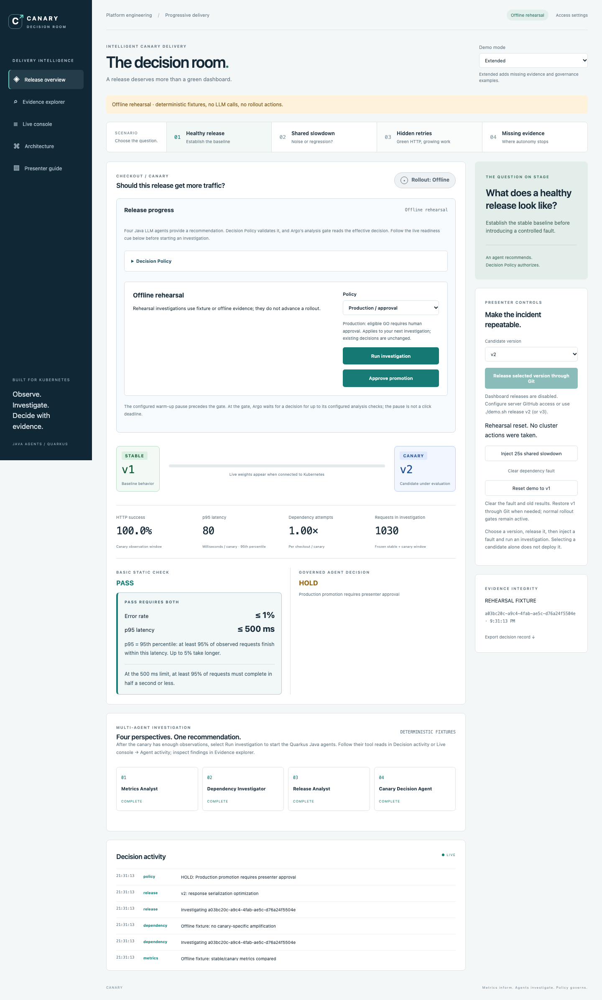
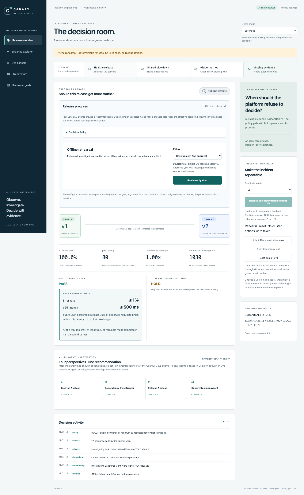

<div class="chapter-meta">04 / PLATFORM GOVERNANCE / BOUNDED AUTHORITY</div>

# Govern the decision

The agent team recommends an outcome. **Decision Policy** determines whether that recommendation is eligible to influence Argo Rollouts. It is implemented in **Java/Quarkus**, primarily in [DecisionPolicy.java](https://github.com/danieloh30/intelligent-canary-delivery/blob/main/src/main/java/dev/danieloh/canary/service/DecisionPolicy.java), with orchestration and release-identity checks at the service/API boundary. It is a deterministic set of application rules, evaluated independently of the LLM’s recommendation.

The policy covers four practical concerns:

- **Traffic and freshness:** at least 30 requests per revision, with decisions expiring 120 seconds after evidence capture.
- **Evidence quality:** HOLD for missing required evidence, invalid references, unsuccessful mandatory tool reads, or unresolved limitations.
- **Customer safety:** enforce error, latency, and retry limits; an LLM GO cannot override them. The retry safety budget produces NO-GO when canary attempts per checkout exceed 2 AND exceed twice stable, with a sampled retrying canary request and its trace-linked log. Fresh, complete evidence and at least 30 requests per cohort remain prerequisites. Approval cannot override NO-GO.
- **Human approval:** production promotion requires an explicit presenter approval when the recommendation is otherwise eligible.

The SPA’s expandable **Decision Policy** explanation summarizes these rules. Evidence explorer shows their resulting effective decision.

## 1. Demonstrate human-in-the-loop (HITL) approval

Choose **Development / no approval** for the core slowdown/retry flow. Choose **Production / approval** before a fresh investigation when demonstrating human approval. The selection applies to the next investigation; changing the dropdown does not alter a completed or running decision. Repeat the fresh investigation and approval at each Production gate.

This HITL capability already exists. Use it as an **Extended** demonstration after the core shared-slowdown/retry story, so the audience first understands investigation and then sees the authority boundary.

1. At an active analysis gate, wait for the green readiness cue and fresh observations for both revisions.
2. Select **Production / approval** and run the four-agent investigation explicitly.
3. In Evidence explorer, compare the agent’s **GO recommendation** with the policy’s **HOLD effective decision** and approval requirement.
4. Select **Approve promotion** while the evidence is still fresh. The policy rechecks eligibility; a valid approval changes the effective decision to GO.
5. Watch the progress panel advance. A later gate requires a fresh investigation and, when using Production policy, a fresh approval.

When the model recommends GO and all safety requirements pass, the effective result remains **HOLD**. The UI exposes **Approve promotion**. Approving the pending decision runs the policy checks again; it does not bypass them.

<figure markdown>

[](../images/screenshots/06-production-approval.png)

<figcaption>Local rehearsal fixture: Production policy holds an otherwise healthy recommendation pending approval. This SPA capture uses deterministic fixtures, not live LLM output. Approval still rechecks evidence and policy. Select the image for full resolution.</figcaption>
</figure>

The presenter token authorizes this demonstration action. Production identity, role separation, and approval audit storage need their own implementation before using this design outside a demo.

## 2. Withhold required evidence

The lesson is **absence of evidence is not evidence of safety**. This scenario demonstrates a required evidence boundary, rather than another application failure.

### Enterprise context and attendee insight

**Illustrative case:** a healthy-looking release coincides with a tracing collector outage, telemetry pipeline misconfiguration, or an access problem. HTTP success and latency remain green, but the platform cannot inspect required dependency observations. Promoting on that partial picture would turn uncertainty into permission.

In this demo, selecting Missing evidence and running an investigation deliberately withholds trace observations and records a **presenter-injected trace evidence outage**. Metrics remain observations from real cluster requests. It does not stop Jaeger or demonstrate an actual tracing backend failure. The recorded missing prerequisite makes deterministic Decision Policy return **HOLD**, irrespective of an optimistic model recommendation.

### Presenter sequence

1. Use a healthy **v2** candidate at an active analysis gate, with no shared slowdown and at least 30 observations in both cohorts. A completed/aborted gate needs a fresh release first.
2. Select **Development / no approval** to isolate evidence completeness from the separate human-approval example.
3. Switch **Demo mode → Extended**, choose **Missing evidence**, confirm candidate v2, and run the stage-specific investigation. Selecting the scenario alone does not run agents or change the cluster.
4. Open **Evidence explorer**. Show healthy HTTP signals alongside the empty trace observations and missing-evidence entry in the raw observation window. Then show **Recommendation → Decision Policy**, the effective HOLD, and its missing-evidence reason. Release overview should show the same HOLD for that current stage; rollout identity is kept separately from the deliberately withheld traces. Distinguish any agent uncertainty from the platform's mandatory prerequisite.
5. Explain that **Approve promotion cannot override missing evidence**. An approval supplies human authorization; it cannot supply observations that were never collected. NO-GO rejects an evidenced regression; this HOLD withholds judgment because required information is absent.
6. Choose **Healthy release**, confirm the same active candidate, and investigate again to collect a fresh complete snapshot. This clears the scene's deliberate trace withholding; it does not repair a real external outage. If fresh evidence meets all rules and the agents support promotion, Development can produce GO; Production additionally requires eligible human approval.

**Say:** “The dashboard is green, but our required trace evidence is unavailable. The platform holds rather than turning uncertainty into permission. We restore evidence and reassess.”

**Audience takeaway:** trust in automation comes from explicit evidence requirements, controlled failure behavior, and reviewable decisions—not confidence in model wording. This is one deliberate missing-trace case; it is not a complete production observability or compliance system.

[](../images/screenshots/15-missing-evidence.png)

*Local rehearsal fixture: healthy HTTP metrics do not satisfy the required evidence contract. The deliberate missing-trace scenario produces HOLD without a live telemetry outage or model call. Inspect the missing entry and saved policy reason in Evidence explorer.*

Scenario 02 asks whether a slowdown is shared, scenario 03 exposes hidden retry cost, and scenario 04 shows where automation must stop because it cannot justify a decision.

## 3. Inspect the deterministic checks

The platform validates:

- Evidence freshness: decisions expire 120 seconds after capture.
- Minimum traffic: at least 30 observed requests per revision.
- Required evidence and successful mandatory tool reads.
- Valid specialist findings and final evidence references.
- The hard 10% canary error cap.
- Customer health before GO: p95 at most 500 ms and errors at most 1%.
- Production approval when applicable.
- The current release, pod-template hash, and rollout step at analysis time.

Java-computed tool comparisons keep milliseconds and sample thresholds explicit. A targeted consistency review catches false sample-shortage and latency-limit claims, allows one correction using the same frozen evidence, and retains original/corrected reports in Evidence explorer. It does not establish root cause or guarantee that every prose error is detected. Unresolved contradictions retain HOLD unless independently corroborated hard safety evidence requires NO-GO.

Model execution has an 85-second orchestration deadline, bounded per-call timeouts, and a 12-tool investigation budget. Failures and unfinished investigations produce HOLD. Local fixture decisions cannot authorize a live rollout.

## 4. Follow the Argo contract

The shared AnalysisTemplate polls the authenticated decision endpoint every five seconds:

- `GO` satisfies the success condition.
- `NO_GO` satisfies the failure condition.
- `HOLD` satisfies neither and remains inconclusive while the measurement budget lasts.

The template allows 180 HTTP checks at five-second intervals—roughly 15 minutes plus execution overhead. These polls read the saved decision; they do not invoke the LLM. A completed inconclusive run does not automatically restart. Fix the cause, then re-enter the same release through GitOps with a fresh pod-template identity or release a new candidate:

```bash
./demo.sh retry-analysis
```

This helper uses the Git release path and requires a clean working tree. It creates a fresh pod-template identity and does not force promotion. The SPA’s release/reset controls provide the corresponding fresh-run path without changing consoles.

## 5. Export the decision record

Use **Export decision record** in the UI. It includes source evidence, findings, recommendation, policy result, and investigation identity.

!!! warning "Demo retention"
    Recent decisions and observations are bounded in-memory data. Prometheus and Jaeger use ephemeral storage. Export records before restarting. Production audit retention, encryption, and access review are separate concerns.

<div class="checkpoint" markdown>

### Checkpoint

You can demonstrate a model recommending GO while policy withholds authority, and explain why approval cannot override stale or missing evidence.

</div>

Review the [presenter playbook](../demo-design.md) to choose the 10-minute or 15-minute flow.
