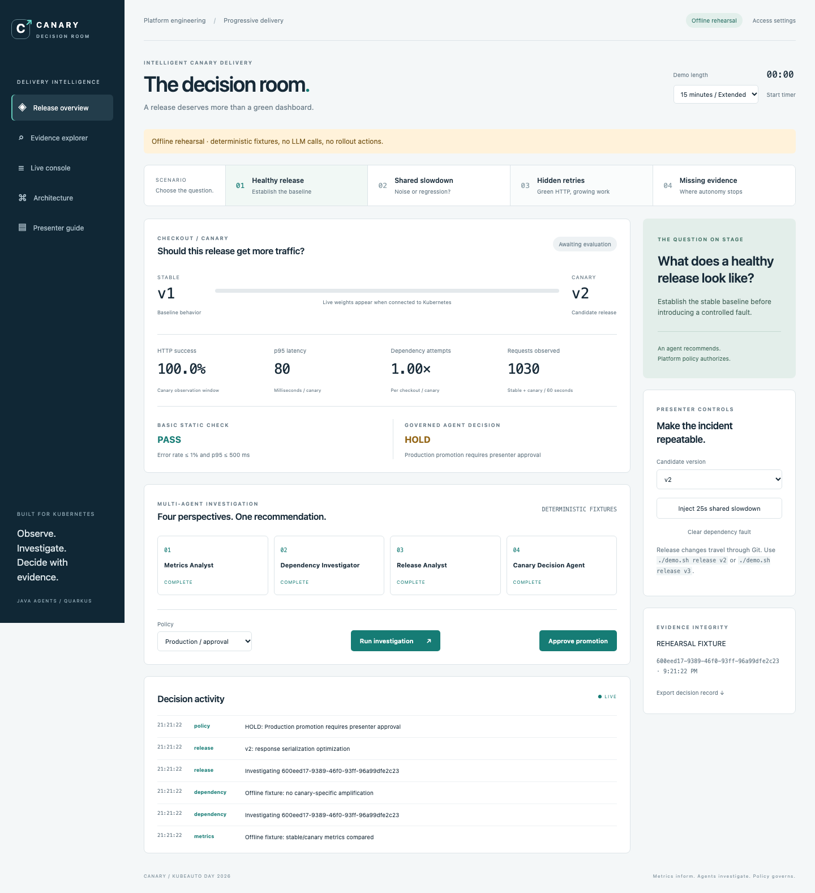

<div class="chapter-meta">04 / PLATFORM GOVERNANCE / BOUNDED AUTHORITY</div>

# Govern the decision

The agent team recommends an outcome. Java policy determines whether that recommendation is eligible to influence Argo Rollouts.

## 1. Apply production policy

Use a healthy candidate with fresh observations. Select **Production / approval** and run an investigation.

When the model recommends GO and all safety requirements pass, the effective result remains **HOLD**. The UI exposes **Approve promotion**. Approving the pending decision runs the policy checks again; it does not bypass them.

<figure markdown>

[](../images/screenshots/06-production-approval.png)

<figcaption>Local rehearsal fixture: Production policy holds an otherwise healthy recommendation pending approval. This SPA capture uses deterministic fixtures, not live LLM output. Approval still rechecks evidence and policy. Select the image for full resolution.</figcaption>
</figure>

The presenter token authorizes this demonstration action. Production identity, role separation, and approval audit storage need their own implementation before using this design outside a demo.

## 2. Withhold required evidence

Switch the demo-length selector to **15 minutes / Extended** and choose **Missing evidence**.

In cluster mode, this scene deliberately withholds trace observations and records a presenter-injected trace evidence outage. Metrics remain observations from real requests. The policy requires HOLD because the mandatory evidence is incomplete.

This is an explicit fault injection, not an unnoticed failure of the trace backend.

## 3. Inspect the deterministic checks

The platform validates:

- Evidence freshness: decisions expire 120 seconds after capture.
- Minimum traffic: at least 30 observed requests per revision.
- Required evidence and successful mandatory tool reads.
- Valid specialist findings and final evidence references.
- The hard 10% canary error cap.
- Customer health before GO: p95 at most 500 ms and errors at most 1%.
- Production approval when applicable.
- The current release, pod-template hash, and rollout step at analysis time.

Model execution has an 85-second orchestration deadline, bounded per-call timeouts, and a 12-tool investigation budget. Failures and unfinished investigations produce HOLD. Local fixture decisions cannot authorize a live rollout.

## 4. Follow the Argo contract

The shared AnalysisTemplate polls the authenticated decision endpoint every five seconds:

- `GO` satisfies the success condition.
- `NO_GO` satisfies the failure condition.
- `HOLD` satisfies neither and remains inconclusive while the measurement budget lasts.

The analysis waits up to 15 minutes. A completed inconclusive run does not automatically restart. Fix the cause, then re-enter the same release through GitOps with a fresh pod-template identity or release a new candidate:

```bash
./demo.sh retry-analysis
```

This helper requires the Argo Rollouts CLI plugin. It does not force promotion.

## 5. Export the decision record

Use **Export decision record** in the UI. It includes source evidence, findings, recommendation, policy result, and investigation identity.

!!! warning "Demo retention"
    Recent decisions and observations are bounded in-memory data. Prometheus and Jaeger use ephemeral storage. Export records before restarting. Production audit retention, encryption, and access review are separate concerns.

<div class="checkpoint" markdown>

### Checkpoint

You can demonstrate a model recommending GO while policy withholds authority, and explain why approval cannot override stale or missing evidence.

</div>

Review the [presenter playbook](../demo-design.md) to choose the 10-minute or 15-minute flow.
